<div align="center">

# LG-USB-2-ETH0

**Make a USB Ethernet adapter the TV's `eth0` on rooted LG webOS TVs, safely and at every boot.**

[](https://github.com/ohmybahgosh/LG-USB-2-ETH0/actions/workflows/ci.yml)
[](https://github.com/ohmybahgosh/LG-USB-2-ETH0/releases/latest)
[](#more-drivers-on-the-way)
[](LICENSE)
[](https://github.com/tolgakurtuluss/awesome-webos)
[](https://ohmybahgosh.dev/lg-usb-2-eth0/)
[](https://github.com/ohmybahgosh/LG-USB-2-ETH0/stargazers)

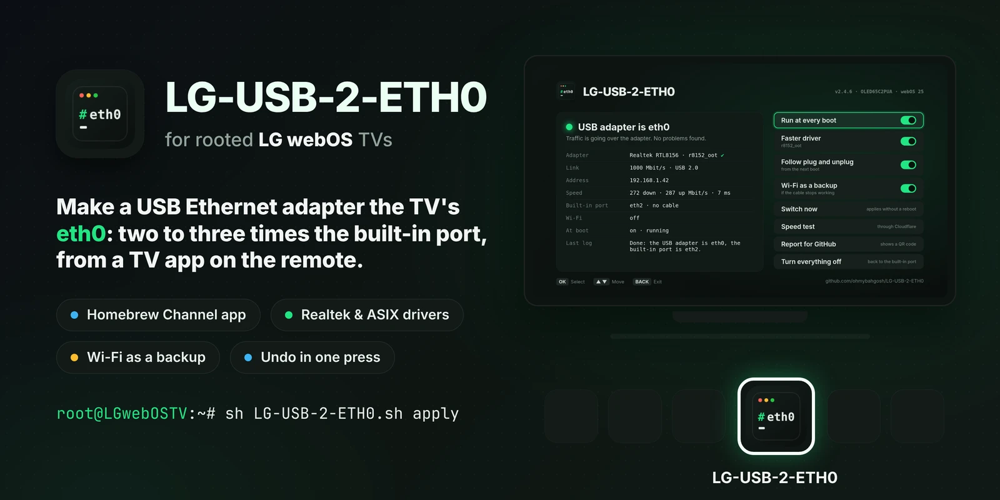

**[Get the TV app](#with-the-tv-app)** · **[Install over SSH](#over-ssh)** · **[Drivers](#drivers)** · **[Troubleshooting](#troubleshooting)** · **[Project page](https://ohmybahgosh.dev/lg-usb-2-eth0/)**

</div>

LG TVs ship with a 100 Mbit/s wired port.  A gigabit USB adapter is two to three times faster on the same TV, even on the USB 2.0 ports many models have (a 2022 C2 included).  But webOS names it `eth1`, and parts of webOS only look at `eth0`.  So the settings screen says "Not Connected" while the internet works, and some streaming apps refuse to play.

LG-USB-2-ETH0 renames the adapter to `eth0` and parks the built-in port under another name, so webOS and its apps treat the adapter as the TV's wired connection.  A small boot hook does it again at every start.  Use the TV app from the Homebrew Channel, with no SSH needed, or the same script over SSH.  It can also find, check and install a better driver for your adapter, test new ones built for your TV, keep the TV wakeable over the network, and block firmware updates harder.

## Standout features

- **A TV app, no SSH needed.**  Everything is a switch on the remote, through the [Homebrew Channel](https://github.com/webosbrew/webos-homebrew-channel), in English, Russian or Spanish.  The same script runs underneath, so SSH works too.  [The TV app](#the-tv-app)
- **The adapter becomes the TV's real `eth0`.**  The settings screen shows the wired connection, and streaming apps that refuse `eth1` play again.  A small boot hook does it at every start, and one press undoes it.  [What it fixes](#what-it-fixes)
- **Two to three times the built-in port.**  272 Mbit/s down and 287 up on a 2022 C2's USB 2.0 port, against about 95 on LG's 100 Mbit/s port.  [Real speeds](#real-speeds)
- **A faster driver, found for your exact kernel.**  **Faster driver** only shows up when a Realtek or ASIX driver is known for your TV's kernel and a supported adapter is plugged in, then downloads it, checks its SHA-256 and sets it up in one go.  [Drivers](#a-faster-driver)
- **Test new drivers from the couch.**  Drivers for many more TVs are built here from LG's own kernel source.  **Test a new driver** loads one until the next restart, checks the adapter gets online, and shows a QR code that opens a filled-in test report.  [Waiting for testers](#more-drivers-on-the-way)
- **Realtek mode.**  An RTL8152 or RTL8153 left on the slow generic driver is switched to its Realtek configuration, so the TV's own `r8152` takes it on kernels that have it built in, with no download at all.  [Drivers](#drivers)
- **Turn the TV on over the network.**  **Wi-Fi wake in standby** keeps Wake on LAN, Turn on via Wi-Fi, the ThinQ app and Home Assistant working with an adapter in, and keeps your traffic on the cable.  [Waking the TV over Wi-Fi](#waking-the-tv-over-wi-fi)
- **Block updates harder.**  Closes the gaps people found in the Homebrew Channel's update block, so a firmware update that could take root away has a much harder time getting through.  [Blocking updates](#blocking-updates)
- **Survives standby and unplugging.**  **Follow plug and unplug** keeps the adapter `eth0` when it's moved, puts it back on the faster driver after standby, and restarts a hung adapter.  **Wi-Fi as a backup** turns Wi-Fi on if the cable stops working.  [How it works](#how-it-works)
- **Finds problems for you.**  The status screen points out a cable stuck at 100 Mbit/s, traffic going over Wi-Fi, Wi-Fi with the adapter's IP, no update block, and more, with what to do.  [Troubleshooting](#troubleshooting)
- **Speed test and reports.**  A speed test against Cloudflare, and a QR code that opens a compatibility report on your phone, filled in with MAC addresses hidden.  [The TV app](#the-tv-app)
- **Hard to break the TV.**  No system files touched, checked downloads, a fallback for every change, and 123 tests under the TV's own busybox shell on every push.  [Is it safe?](#is-it-safe-and-how-do-i-undo-it)

> [!TIP]
> **Help make it work on more TVs.**  This project grows from people trying it on their own TVs.  Any of these helps, and gets your name in [Special thanks](#special-thanks):
>
> - 🧪 **Test a driver** built for your TV: if it has one waiting, the app shows **Test a new driver**, and one press tests it and fills in the report.  [Drivers waiting for testers](#more-drivers-on-the-way)
> - 📺 **Send a compatibility report**, whether it worked or not: the app's **Report for GitHub** QR code fills it in from your phone.  [Report form](https://github.com/ohmybahgosh/LG-USB-2-ETH0/issues/new?template=compatibility-report.yml)
> - 🌍 **Translate the app** into your language.  [How](#translating-the-app)
> - 🤖 **Build a feature with AI:** attach the [knowledge base](https://github.com/ohmybahgosh/LG-USB-2-ETH0/releases/latest/download/lg-usb-2-eth0-for-ai.md) to Claude, ChatGPT or Gemini first.  [Contributing](#contributing)
> - 💬 **Ask, share your setup or suggest an idea** in [Discussions](https://github.com/ohmybahgosh/LG-USB-2-ETH0/discussions).

> [!WARNING]
> **Keep firmware updates off on a rooted TV.**  LG's current firmware patches the known ways to root a TV, including webOS 26 firmware released after October 10, 2026.  An update may remove root for good, and this tool stops working with it.  Turn off **Automatic software updates** in the TV's settings, turn on **Block system updates** in the Homebrew Channel, and turn on **Block updates harder** in this app ([how it works](#blocking-updates)).

<details>
<summary><b>More on firmware updates and root</b></summary>

<br>

LG has started rolling out webOS 26 to 2022 to 2025 models (version 43.21.94 for the C2, 43.21.96 for the C3, C4 and C5, as of early November 2026).  Those, and other webOS 26 firmware released after October 10, 2026 (like 43.21.84), can't be rooted, per the [EPK archive's rooting guide](https://tv.slada.sk/guides/rooting-guide).  Earlier webOS 26 firmware, like the 2026 models' launch firmware, still can.  Once a TV is on patched firmware, it can't be rooted again.

- Turn off **Automatic software updates** in the TV's settings (on recent models it's under Support, Software Update).
- In the Homebrew Channel, open Settings and turn on **Block system updates**.
- Turn on **Block updates harder** in the LG-USB-2-ETH0 app (or install with `--block-updates`).  It adds to the Homebrew Channel's block without touching it: see [Blocking updates](#blocking-updates).
- Some TVs still show the update prompt anyway.  Blocking LG's update servers on your router or Pi-hole stops it: see the list in [Homebrew Channel issue #96](https://github.com/webosbrew/webos-homebrew-channel/issues/96#issuecomment-2119483327).
- Not sure about your firmware?  Check it at [CanI.RootMy.TV](https://cani.rootmy.tv/).

People keep looking for new ways in.  RootMyTV, crashd, WTA, DejaVuln and faultmanager each came along after the one before it was patched, so a root method for newer firmware may well turn up, but there's no telling when.  The [webOS Homebrew rooting page](https://www.webosbrew.org/rooting/) is the place to watch.

</details>

<details>
<summary><b>How this is built: AI-assisted, tested on a real TV</b></summary>

<br>

I, [OhMyBahGosh](https://github.com/ohmybahgosh), wrote v1 by hand.  From v2.0 on, it's written with AI coding agents (Claude), directed, reviewed and tested by me.  I've been building software for over 17 years.  My day job is data engineering, and network security and pentesting are what I do for fun.  AI writes a lot of the code here; I decide what it does, check how it does it, and nothing ships until it's run on a real TV (an LG C2 on webOS 25).

The fixes that mattered most came from that real-TV testing, not from the AI: standby putting the adapter back on the slow driver, webOS quietly sending traffic over Wi-Fi instead of the adapter, and the GitHub report form opening blank on a phone.  The [changelog](CHANGELOG.md) has the full story.

- **Tests on every push:** 123 [tests](tests/run.sh) run the script against a fake `/sys` under busybox `sh` (the TV's shell), dash and bash, along with ShellCheck, a build of the TV app, and a check of the issue forms.  The CI badge above shows the latest run.
- **Checked downloads:** driver modules and updates come from fixed releases or commits and are kept only if their SHA-256 matches.  A driver is only loaded on the exact kernel it was built for, and only offered for adapters it supports.
- **Hard to break the TV:** no system files are touched, the boot hook is a link that stops running if the app is removed, every change has a fallback, and a reboot without the hook always starts clean.

The tested driver modules `get-driver` offers were built by [DonZoomik](https://github.com/DonZoomik/webos-r8152), [mbenitez343](https://github.com/mbenitez343/lg-webos-2024-ethernet-fix), [OCT0PUSCRIME](https://github.com/OCT0PUSCRIME/lg-webos-ax88179-driver), [dd3git](https://github.com/dd3git/lg-webos-ax88179-driver) and [throwaway96](https://github.com/throwaway96/webos-kernel-drivers); this script only checks and loads them.  The ones waiting for testers are built here, from LG's own kernel source ([docs/driver-build.md](docs/driver-build.md)).  Commits list me as the author and Claude as the committer, which is why they show as Verified.  Found a problem?  See [SECURITY.md](SECURITY.md) or open an issue.

</details>

## Contents

- [Standout features](#standout-features)
- [What it fixes](#what-it-fixes)
- [Get started](#get-started): [the TV app](#with-the-tv-app), [over SSH](#over-ssh), [is it safe?](#is-it-safe-and-how-do-i-undo-it)
- [The TV app](#the-tv-app)
- [Choosing an adapter](#choosing-an-adapter)
- [Drivers](#drivers): [known to work](#a-faster-driver), [waiting for testers](#more-drivers-on-the-way)
- [Real speeds](#real-speeds)
- [webOS compatibility](#webos-compatibility)
- [Blocking updates](#blocking-updates)
- [Waking the TV over Wi-Fi](#waking-the-tv-over-wi-fi)
- [Troubleshooting](#troubleshooting) and [FAQ](#faq)
- [Commands and options](#commands-and-options) and [how it works](#how-it-works)
- [Upgrading from v1](#upgrading-from-v1)
- [Development and tests](#development-and-tests), [Contributing](#contributing), [Special thanks](#special-thanks), [Thanks](#thanks)

## What it fixes


| Problem | What you see | What this does |
|---------|--------------|----------------|
| **Streaming apps fail** | Apps like Paramount+ refuse to play over `eth1` | The adapter becomes `eth0` |
| **"Not Connected" in settings** | webOS shows no wired connection while the adapter works | Interface names match what webOS expects |
| **100 Mbit/s built-in port** | High-bitrate remuxes, Plex and Moonlight stutter | Uses the faster adapter (see [Real speeds](#real-speeds)) |
| **No driver for the adapter** | The adapter isn't detected, or sits on a slow generic driver | Finds, checks and loads a driver built for your exact kernel (see [Drivers](#drivers)) |

## Get started

You need:

- A rooted LG TV with the [Homebrew Channel](https://github.com/webosbrew/webos-homebrew-channel).  Check yours at [cani.rootmy.tv](https://cani.rootmy.tv/).
- A USB Ethernet adapter.  The chip matters more than the brand: see [Choosing an adapter](#choosing-an-adapter).
- **A Wi-Fi connection while you set this up.**  Switching takes the wired ports down for a moment, and Wi-Fi is your way back in.

### With the TV app

The easiest way, with no SSH at all.

1. Open the Homebrew Channel, go to **Settings**, and add the repository `https://ohmybahgosh.dev/repo`.
2. Install **LG-USB-2-ETH0** from the list and open it.
3. Turn on **Run at every boot**, and press **Switch now** to switch without a reboot.

The Homebrew Channel then offers updates like for any other app.

<details>
<summary>Or install the IPK yourself</summary>

<br>

Download `org.ohmybahgosh.lgusb2eth0_*.ipk` from the [latest release](https://github.com/ohmybahgosh/LG-USB-2-ETH0/releases/latest) and install it with `ares-install`, or copy it to `/media/developer/temp` on the TV (on webOS 25 and older, `/tmp` works too; webOS 26's installer can't read `/tmp`) and run this, with the file name you downloaded:

```sh
luna-send -n 1 luna://com.webos.appInstallService/dev/install '{"id":"org.ohmybahgosh.lgusb2eth0","ipkUrl":"/media/developer/temp/org.ohmybahgosh.lgusb2eth0_2.4.11_all.ipk"}'
```

</details>

### Over SSH

The same thing without the app, if you'd rather see every step.  You need SSH (or telnet) access as root.  On the TV:

```sh
cd /tmp

# Download the latest release and its checksum
curl -fsSLO https://github.com/ohmybahgosh/LG-USB-2-ETH0/releases/latest/download/LG-USB-2-ETH0.sh
curl -fsSLO https://github.com/ohmybahgosh/LG-USB-2-ETH0/releases/latest/download/SHA256SUMS
sha256sum -c SHA256SUMS

# See what the TV has before changing anything (read-only)
sh LG-USB-2-ETH0.sh status

# Install the boot hook (asks before it writes anything)
sh LG-USB-2-ETH0.sh install

# Optional: switch right now instead of at the next reboot
sh LG-USB-2-ETH0.sh apply
```

No `curl`?  Use `wget` the same way.  If both fail with a TLS error (common on older firmware), download the two files on your computer and copy them over with `scp`.  Run `sh LG-USB-2-ETH0.sh` with no arguments for a menu, and see [Commands and options](#commands-and-options) for the rest.

Already set up over SSH?  Open the app and it picks up your settings.  Its boot hook links to the copy of the script inside the app, so the app and the hook always run the same version.

<details>
<summary>What <code>status</code> looks like once it's working</summary>

```
=== LG-USB-2-ETH0 v2.4.11 status ===
Model:     OLED65C2PUA
webOS:     webOS 25 (10.x), firmware 33.x
Kernel:    aarch64, 5.4.x

Boot hook
  Installed and enabled (/var/lib/webosbrew/init.d/S01fix-eth -> /home/root/lg-usb-2-eth0/LG-USB-2-ETH0.sh)
  Waits 120s

Network interfaces
  eth0      USB Ethernet       driver r8152          00:e0:4c:68:12:34
            cable in, link 1000 Mbit/s, IPv4 192.168.1.42/24, on USB 2.0
  eth2      built-in Ethernet  driver lg-eth         a8:23:fe:00:00:01
            no cable, IPv4 none
  wlan0     Wi-Fi              driver mt7601u        00:11:22:33:44:55
            connected, IPv4 none
  Default route: eth0

USB network drivers on this kernel
  r8152(loaded) cdc_ncm(loaded) usbnet(loaded)

The USB adapter is eth0 and the built-in port is eth2.

Last log lines (/var/lib/webosbrew/lg-usb-2-eth0.log)
  Built-in eth0 -> eth2
  USB eth1 (r8152) -> eth0
  Done: the USB adapter is eth0, the built-in port is eth2.

No problems found.
Notes:
  - The Homebrew Channel blocks four of LG's update servers, but misses others.  install --block-updates closes the rest.
  - eth0 is on USB 2.0, which tops out around 300 Mbit/s on these TVs.
```

This sample comes from the test suite, with example TV details filled in.  Your model, firmware and driver names will differ.

</details>

### Is it safe, and how do I undo it?

It adds one boot hook, a link at `/var/lib/webosbrew/init.d/S01fix-eth`, keeps its settings in `/var/lib/webosbrew/lg-usb-2-eth0.conf`, and only renames network interfaces.  No system files are touched, and network settings only if you turn on the Wi-Fi backup or Block updates harder.  With no adapter plugged in, the hook changes nothing, and a reboot without it always starts clean.

To undo everything, press **Turn everything off** in the TV app (do this before you remove the app), or run `sh LG-USB-2-ETH0.sh uninstall --now`.

## The TV app

It runs the same script underneath, as root through the Homebrew Channel.  It works with the remote's arrows and OK, or the Magic Remote pointer.

<p align="center">
  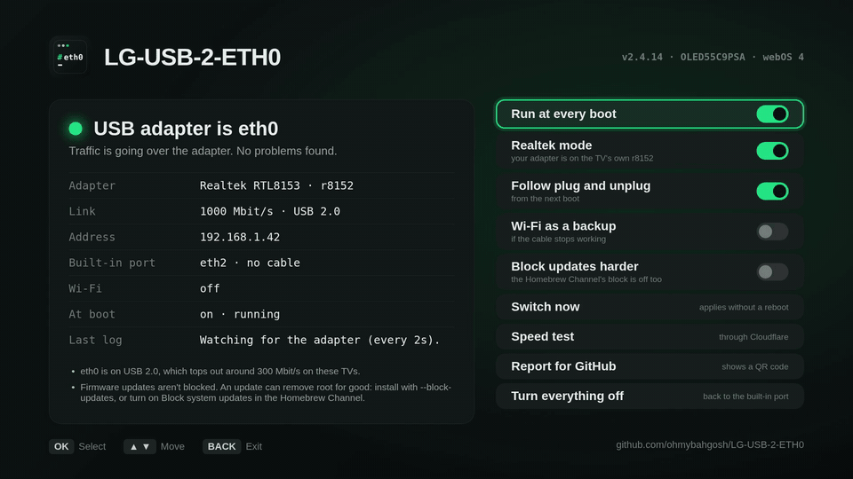
</p>

- **Status at a glance:** whether the adapter is `eth0`, its driver, link speed, USB bus, address, Wi-Fi, and any problems found, like a cable that only connects at 100 Mbit/s.
- **Run at every boot**, **Follow plug and unplug**, **Wi-Fi as a backup**, **Wi-Fi wake in standby**, **Block updates harder** and **Switch now**, as on/off switches.
- **Faster driver:** only shows up when a driver is known for your TV's exact kernel and an adapter it supports is plugged in.  It downloads, checks and sets up the driver in one go.
- **Test a new driver:** only on TVs whose kernel has a driver waiting for testers.  One press downloads and checks it, loads it until the next restart, moves the adapter to it, checks it gets online, and shows a QR code that opens a filled-in test report.
- **Speed test:** download, upload and latency through the TV's current connection, against Cloudflare's nearest server.
- **Report for GitHub:** a QR code that opens a compatibility report on your phone with your TV, adapter, speed and the full report already filled in (MAC addresses hidden).
- **Updates:** tells you when a new version is out.  If you installed through the Homebrew Channel repo, the update comes from there.  Otherwise the app downloads it, checks its SHA-256, and installs it itself.  Either way, the new version opens with a short list of what's new.
- **Turn everything off:** removes the boot hook and gives `eth0` back to the built-in port.
- **Language:** the app follows the TV's menu language, English, Russian or Spanish for now, and the Language row picks one by hand.  That covers the app's screens, the problems and tips on the status screen, and the messages the boot hook shows on the TV.  The script's output after an action, the log, and anything over SSH stay in English.  More languages are welcome: see [Translating the app](#translating-the-app).  Screenshots in [Russian](assets/screenshots/ru/) and [Spanish](assets/screenshots/es/).

<details>
<summary><b>Screenshots</b></summary>

<br>

<table>
  <tr>
    <td width="50%">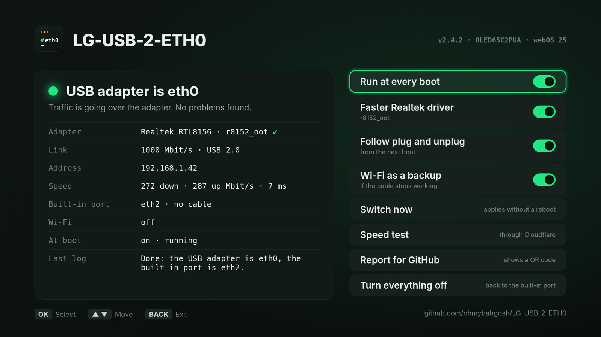</td>
    <td width="50%">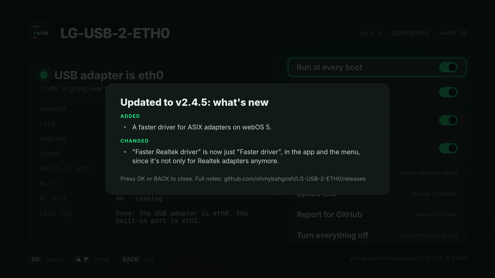</td>
  </tr>
  <tr>
    <td align="center"><b>Status at a glance</b></td>
    <td align="center"><b>Speed test</b></td>
  </tr>
  <tr>
    <td width="50%">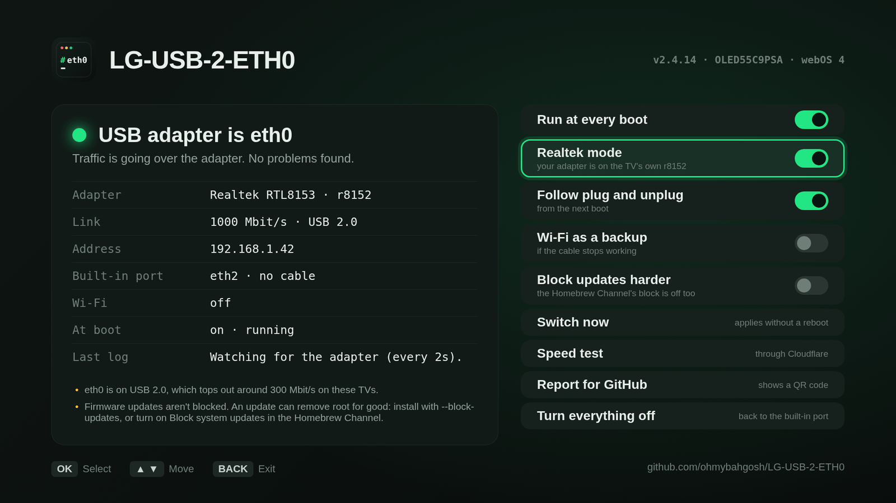</td>
    <td width="50%">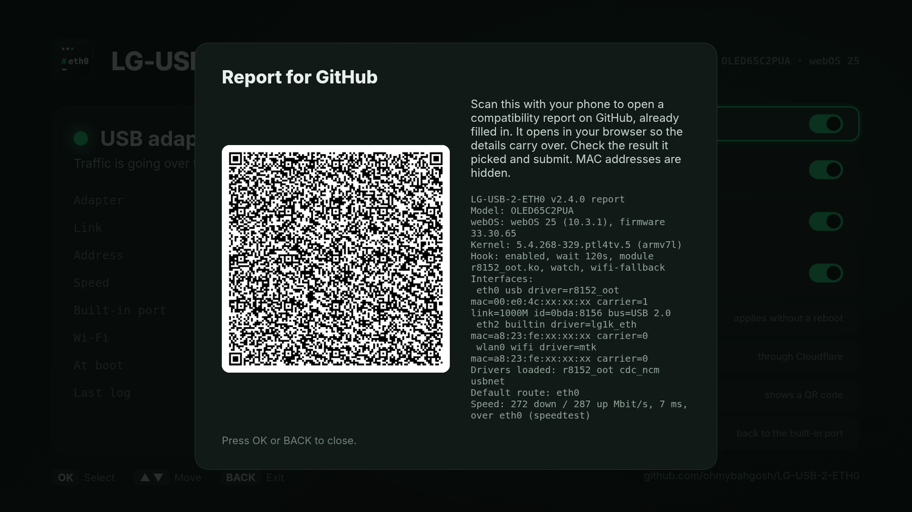</td>
  </tr>
  <tr>
    <td align="center"><b>Realtek mode</b></td>
    <td align="center"><b>Report for GitHub</b></td>
  </tr>
  <tr>
    <td width="50%">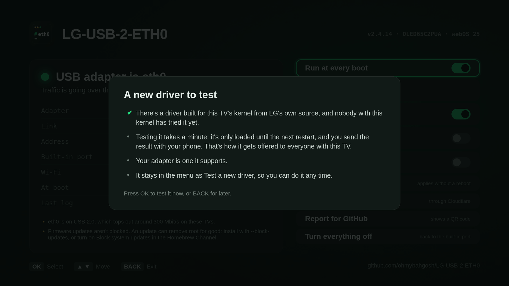</td>
    <td width="50%">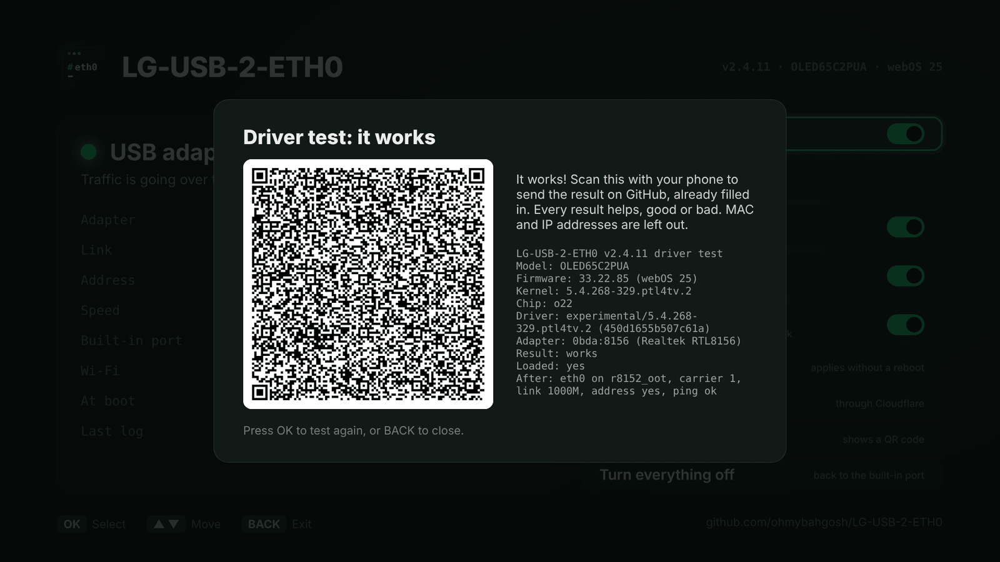</td>
  </tr>
  <tr>
    <td align="center"><b>A new driver to test</b></td>
    <td align="center"><b>Its result, ready to send</b></td>
  </tr>
  <tr>
    <td width="50%">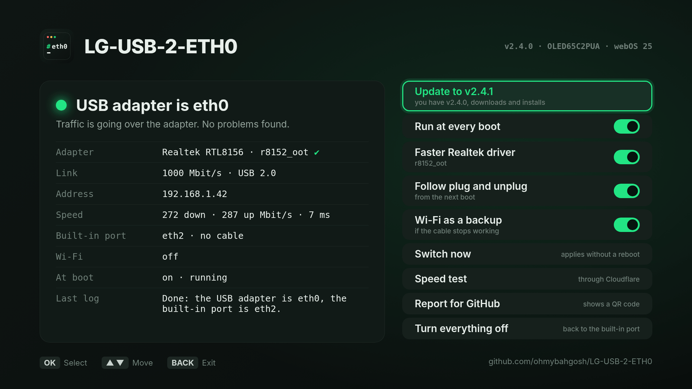</td>
    <td width="50%">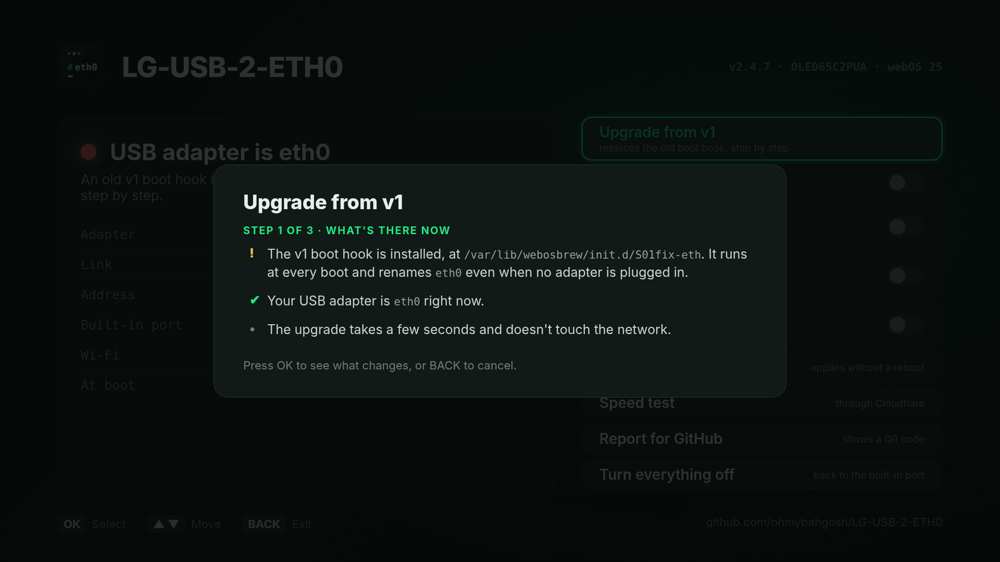</td>
  </tr>
  <tr>
    <td align="center"><b>Updates</b></td>
    <td align="center"><b>Upgrading from v1</b></td>
  </tr>
</table>

<b>In motion</b>

<table>
  <tr>
    <td width="50%">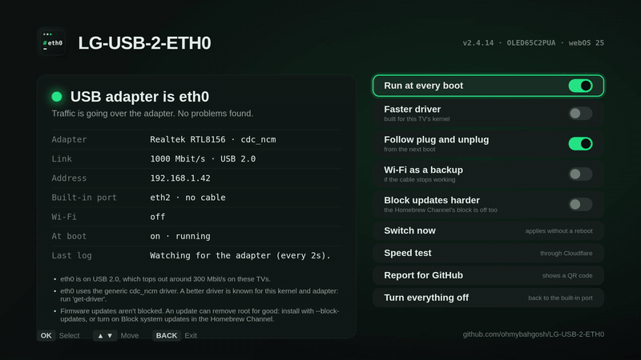</td>
    <td width="50%">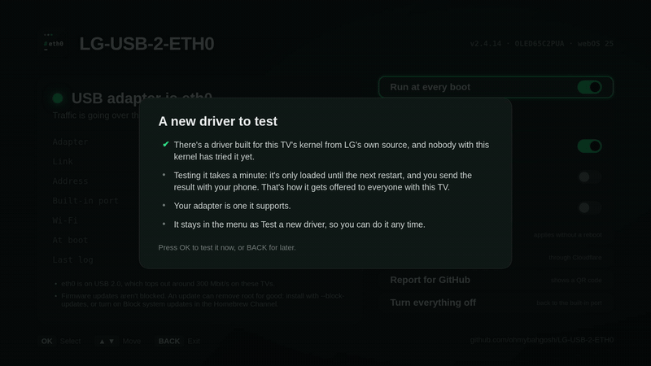</td>
  </tr>
  <tr>
    <td align="center"><b>Faster driver</b></td>
    <td align="center"><b>Test a new driver</b></td>
  </tr>
  <tr>
    <td width="50%">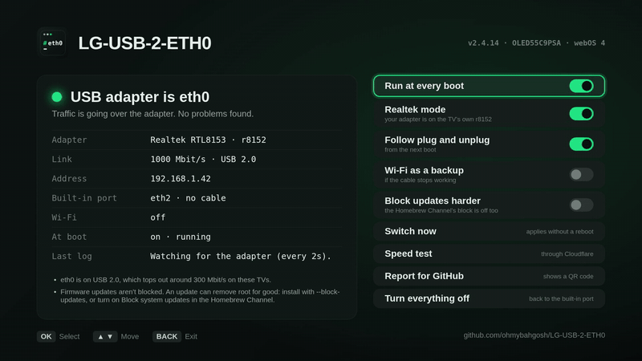</td>
    <td width="50%">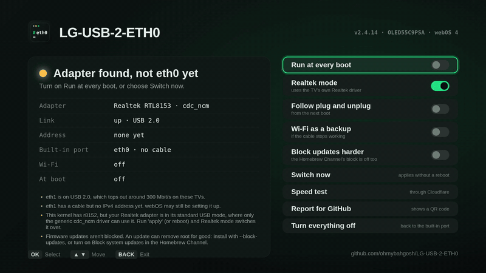</td>
  </tr>
  <tr>
    <td align="center"><b>Realtek mode</b></td>
    <td align="center"><b>Switch now</b></td>
  </tr>
</table>

<sub>The recording above, the clips and most screenshots are from the <a href="scripts/virtual-tv/">virtual TV</a>: the app and the real script, on a made-up C2 with an RTL8156 adapter and a C9 with an RTL8153.  The update and v1 upgrade screenshots use made-up data from <a href="scripts/screenshots/">scripts/screenshots</a>.</sub>

</details>

## Choosing an adapter

What decides whether this works on your TV is **whether its kernel has a driver for your adapter's chip**.  That varies by model and firmware, not just by webOS version.  The chip matters more than the brand.

- **Realtek RTL8153 (gigabit) and RTL8156 (2.5G):** the most common chips.  Newer kernels may only have the generic `cdc_ncm` driver for them, which works but is slower, and some models have no Realtek driver at all.  `get-driver` may offer a better one, or `test-driver` a new one: see [Drivers](#drivers).
- **ASIX AX88179:** works out of the box on many TVs, using the TV's own `ax88179_178a` driver, like a 2024 G4 on webOS 25 ([#2](https://github.com/ohmybahgosh/LG-USB-2-ETH0/issues/2)).  Where the kernel has no ASIX driver, there's often one to get or test.
- **Aquantia AQC111/AQC112, Davicom DM9601 and Microchip LAN78xx:** no LG kernel includes these drivers, so they don't work out of the box on any LG TV.  There's a driver to test for most kernels: see [More drivers on the way](#more-drivers-on-the-way).  A Realtek or ASIX adapter is the safer buy.
- **USB 2.0 is fine.**  Many LG TVs, the C2 included, only have USB 2.0 ports.  There you'll top out around 300 Mbit/s, still about three times the built-in port.  If your TV does have a USB 3.0 port (usually the blue one), use it for more.

Before buying, run `sh LG-USB-2-ETH0.sh status`: it lists which USB network drivers your kernel has.  The [firmware audit](docs/firmware-audit.md) lists them too, read straight from LG's firmware.  If you already have an adapter that isn't working, `status` tells you when the kernel sees it but has no driver for it.

### Tested adapters

Adapters confirmed on a real TV.  Plain links: no affiliate codes, no sponsorship, nobody paid for a spot here.

| Adapter | Chip | Tested on | Result |
|---------|------|-----------|--------|
| [UGREEN USB-C to 2.5G Ethernet (Amazon)](https://www.amazon.com/dp/B0CD1FDKT1) | Realtek RTL8156BG (`0bda:8156`) | 2022 C2, webOS 25, USB 2.0 port | Works.  272 Mbit/s down, 287 up with `r8152_oot` (it's on `cdc_ncm` without it) |
| RTL8153 adapter ([#23](https://github.com/ohmybahgosh/LG-USB-2-ETH0/issues/23)) | Realtek RTL8153 (`0bda:8153`) | 2024 C4 (OLED65C4PTA), webOS 25, USB 2.0 port | Works with `r8152_oot` from `get-driver`.  277 Mbit/s down, 286 up, 3 ms, and webOS shows the wired connection |
| TP-Link UE306 V1.6 ([discussion #3](https://github.com/ohmybahgosh/LG-USB-2-ETH0/discussions/3), [Amazon](https://www.amazon.com/dp/B09GRL3VCN)) | ASIX AX88179 (`0b95:1790`) | 2020 UN7300 (55UN7300PUF), webOS 5, USB 2.0 port | Works with OCT0PUSCRIME's `ax88179_178a` build from `get-driver`, since that kernel has no ASIX driver.  228 Mbit/s down, 325 up |
| TP-Link UE306 ([Reddit](https://www.reddit.com/r/webos/s/mNSsjbQGqN)) | ASIX AX88179 | 2024 C4 (OLED65C46LA), USB 2.0 port | Works out of the box on the TV's own `ax88179_178a` driver.  About 300 Mbit/s, and webOS now shows "wired network connected" |
| RTL8153 adapter ([#7](https://github.com/ohmybahgosh/LG-USB-2-ETH0/issues/7)) | Realtek RTL8153 (`0bda:8153`) | 2024 G4 (OLED65G46LA), webOS 24, USB 2.0 port | Works on the TV's own `r8152` once Realtek mode moves it off `cdc_ncm`.  293 Mbit/s down, 285 up, 3 ms, and webOS shows the wired connection |
| Cable Matters USB Ethernet ([#6](https://github.com/ohmybahgosh/LG-USB-2-ETH0/issues/6)) | Realtek RTL8153 (`0bda:8153`) | 2020 UN7300 (55UN7300AUD), webOS 5, USB 2.0 port | Works with the K6Lp `r8152` build from `get-driver`, since that kernel has no Realtek driver.  184 Mbit/s down, 229 up, and webOS shows "Wired Connection (Ethernet), connected to Internet" |
| ASIX AX88179 adapter ([#2](https://github.com/ohmybahgosh/LG-USB-2-ETH0/issues/2)) | ASIX AX88179/178A (`0b95:1790`) | 2024 G4 (OLED65G48LW), webOS 25, USB 2.0 port | Works out of the box on the TV's own `ax88179_178a` driver.  292 Mbit/s down, 51 up |

Got another adapter working?  [Send a compatibility report](https://github.com/ohmybahgosh/LG-USB-2-ETH0/issues/new?template=compatibility-report.yml) (the TV app makes one for you) and it'll be added here.

<details>
<summary>A note on the UGREEN, and more adapters that should work</summary>

<br>

The UGREEN has a USB-C plug and LG TVs have USB-A ports, so on the author's C2 it goes through a small USB-C (female) to USB-A (male) converter ([this 4-pack on Amazon](https://www.amazon.com/dp/B0BJ8YQ2LM)).  It works, but it's just what was on hand.  Those converters are USB 2.0, which is all the C2's port can do anyway, but on a TV with a USB 3.0 port they'd hold the adapter back.  If you're buying, get one with a USB-A plug and skip the converter.

These use the same RTL8156BG chip as the UGREEN, so they should work the same way: on `cdc_ncm` out of the box, and faster with `r8152_oot` where `get-driver` offers it.  None has been tested on a TV yet, so a report helps.

| Adapter | Chip | Plug |
|---------|------|------|
| [UGREEN USB to 2.5G Ethernet, model 25051 (Amazon)](https://www.amazon.com/dp/B0CWV2Q6HJ) | RTL8156BG | USB-A, USB 3.0.  The USB-A version of the UGREEN above. |
| [Cable Matters USB to 2.5Gb Ethernet, model 202485 (Amazon)](https://www.amazon.com/dp/B0GFHS6L87) | RTL8156BG | USB-A, USB 3.0 |
| [SABRENT USB-A to 2.5Gbps Ethernet, NT-UA25 (Amazon)](https://www.amazon.com/dp/B0FMBXSNKL) | RTL8156BG | USB-A, USB 3.0 |

Gigabit adapters on the two chips LG kernels support best.  The chip is from the maker's datasheet or from owners' `lsusb` output (`0bda:8153` is Realtek RTL8153, `0b95:1790` is ASIX AX88179), since most listings don't say.  On a USB 2.0 port these do about as well as the 2.5G ones above, for less.

| Adapter | Chip | Notes |
|---------|------|-------|
| [TP-Link UE300 (Amazon)](https://www.amazon.com/dp/B00YUU3KC6) | Realtek RTL8153 ([TP-Link's datasheet](https://static.tp-link.com/res/down/doc/UE300_V1_Datasheet.pdf)) | USB-A, USB 3.0.  Same chip as the adapters in [#6](https://github.com/ohmybahgosh/LG-USB-2-ETH0/issues/6) and [#7](https://github.com/ohmybahgosh/LG-USB-2-ETH0/issues/7) |
| [TP-Link UE306 (Amazon)](https://www.amazon.com/dp/B09GRL3VCN) | ASIX AX88179 | USB-A, USB 3.0.  Tested above, on two TVs |
| [UGREEN USB 3.0 to Gigabit Ethernet, model 20256 (Amazon)](https://www.amazon.com/dp/B00MYTSN18) | ASIX AX88179 (`0b95:1790`) | USB-A, USB 3.0 |
| [Amazon Basics USB 3.0 to Gigabit Ethernet, U3-GE-1P (Amazon)](https://www.amazon.com/dp/B00M77HMU0) | ASIX AX88179 (`0b95:1790`) | USB-A, USB 3.0 |
| [Plugable USB3-E1000 (Amazon)](https://www.amazon.com/dp/B00AQM8586) | ASIX AX88179B | USB-A, USB 3.0.  A later revision of the AX88179 with the same USB ID, so it should use the same driver |
| [Cable Matters USB 3.0 to Gigabit Ethernet, model 202013 (Amazon)](https://www.amazon.com/dp/B00BBD7NFU) | ASIX | USB-A, USB 3.0.  Cable Matters' support page points to ASIX's drivers.  Not the Realtek Cable Matters adapter in [#6](https://github.com/ohmybahgosh/LG-USB-2-ETH0/issues/6) |

Which one fits your TV depends on its kernel: run `status` first, or look your TV up in the [firmware audit](docs/firmware-audit.md).  Realtek or ASIX, there's usually a driver built in or one to get.  Skip adapters listed with the ASIX AX88179A or AX88772D for now (the StarTech USB31000S is one): they're newer chips that the older kernels on TVs may not handle, and nobody has tried one on a TV yet.

Same deal: plain links, no affiliate codes.  Sellers sometimes change parts without changing the listing, so check the chip in the listing or the reviews before you buy.

</details>

## Drivers

A driver module built for your exact kernel helps in two cases:

- **The adapter is on a slow generic driver.**  Many TVs give Realtek RTL8153 and RTL8156 adapters to `cdc_ncm`.  It works, but it's slower and drops out under load.  The TV's own Realtek driver is often too old to recognize newer chips, and because it's built into the kernel, it can't be swapped out.  A newer Realtek driver under a different name fixes that.
- **The kernel has no driver for the chip at all.**  LG left the Realtek driver out of many recent kernels, and some have no ASIX driver.  None has drivers for Aquantia, Davicom or Microchip LAN78xx chips.  There the adapter isn't detected until a module adds one.

**First, Realtek mode.**  Many LG kernels already have Realtek's driver built in, from 2019's C9 to webOS 25, but it's older than the kernel change that switches a Realtek adapter to its Realtek mode.  So the adapter stays in its standard mode, where only `cdc_ncm` can use it.  Realtek mode, on by default, switches an RTL8152 or RTL8153 adapter over so the TV's own `r8152` takes it, with nothing to download.  If `r8152` doesn't take it within 5 seconds, the adapter goes back to the mode it was in, and `status` suggests a driver from below instead.  It's new and still waiting for reports from TVs, so please [send one](https://github.com/ohmybahgosh/LG-USB-2-ETH0/issues/new?template=compatibility-report.yml).  Turn it off with **Realtek mode** in the app or `--no-realtek-mode`.

There are two kinds: drivers known to work, which **Faster driver** (`get-driver`) sets up, and new drivers waiting for someone with that TV to try them, which **Test a new driver** (`test-driver`) tries.

### A faster driver

These are known to work on a real TV.  Most are built for one exact kernel, and a few for one chip.  `status` says when one fits your TV.

| Driver | For | Built by |
|--------|-----|----------|
| `r8152_oot` (Realtek v2.22.1) | Kernel `5.4.268-329.ptl4tv.5` on webOS 25: the 2022 C2, 2023 C3 and UR9000, and 2024 C4 and G4.  RTL8153 and RTL8156 adapters. | [DonZoomik](https://github.com/DonZoomik/webos-r8152) |
| `r8152` (v1.10.11) | 2024 QNED and OLED on webOS 25, where LG removed the Realtek driver, on kernel `5.4.268-294.17.paparoa.pine.2`.  Gigabit RTL8152 and RTL8153 adapters, not 2.5G ones. | [mbenitez343](https://github.com/mbenitez343/lg-webos-2024-ethernet-fix) |
| `ax88179_178a` (ASIX v1.19.0) | 2020 TVs on webOS 5 (UN7300, kernel `4.4.84-612.jcl4tv.40`), which have no ASIX driver.  Tested with a TP-Link UE306 ([discussion #3](https://github.com/ohmybahgosh/LG-USB-2-ETH0/discussions/3)). | [OCT0PUSCRIME](https://github.com/OCT0PUSCRIME/lg-webos-ax88179-driver) |
| `r8152_oot` (Realtek v2.22.1, from LG's source) | Kernel `5.4.268-320`: OLEDs on webOS 24 firmware 23.20 to 23.25, like the 2024 G4.  Adds RTL8156 (2.5G) adapters, which the TV's own `r8152` doesn't handle.  RTL8153 adapters already work on the TV's own driver at the same speed.  Tested with an RTL8153 on a 2024 G4 ([#8](https://github.com/ohmybahgosh/LG-USB-2-ETH0/issues/8)). | [OhMyBahGosh](https://github.com/ohmybahgosh/lg-webos-usb-drivers/tree/main/experimental/5.4.268-320) |
| `r8152` (from LG's source) | 2020 TVs on webOS 5 with the K6Lp chip (UN7300), kernel `4.4.84-612.jcl4tv.40`, which have no Realtek driver.  Gigabit RTL8152 and RTL8153 adapters.  Tested with a Cable Matters RTL8153 ([#6](https://github.com/ohmybahgosh/LG-USB-2-ETH0/issues/6)). | [OhMyBahGosh](https://github.com/ohmybahgosh/lg-webos-usb-drivers/tree/main/experimental/4.4.84-612.jcl4tv.40-k6lp) |
| `ax88179_178a` (from LG's source) | Kernel `5.4.268-294.24.papikonda.2` on webOS 25: the 2025 B5, and the 2024 B4 and QNED85, none of which has an AX88179 driver.  Tested by its author on a B5. | [dd3git](https://github.com/dd3git/lg-webos-ax88179-driver) |
| `r8152`, `ax88179_178a` | TVs with the Realtek K5Lp chip on kernel 4.4.84, picked by chip.  Gigabit Realtek and ASIX adapters.  Not yet tested with this app. | [throwaway96](https://github.com/throwaway96/webos-kernel-drivers) |

In the TV app it's one switch: **Faster driver**.  Over SSH, two commands, with the file `get-driver` downloaded (`r8152_oot.ko`, `r8152.ko` or `ax88179_178a.ko`):

```sh
sh LG-USB-2-ETH0.sh get-driver
sh LG-USB-2-ETH0.sh install --module /home/root/lg-usb-2-eth0/drivers/r8152_oot.ko
sh LG-USB-2-ETH0.sh apply      # optional: switch now instead of at the next reboot
```

**Set up Wi-Fi on the TV first.**  Moving drivers takes the adapter offline for a moment, and Wi-Fi is your way back in if something goes wrong.  A reboot always undoes a live switch, and `uninstall` removes it for good.

<details>
<summary>How drivers are checked and set up</summary>

<br>

`get-driver` only offers a module for the exact kernel it was built for, and only when an adapter it supports is plugged in (it checks the adapter's USB ID against the module's own list).  Drivers built per chip check the chip name too (`nyx-cmd DeviceInfo query device_name`).  Some modules name only the base kernel version inside (like `5.4.268`), which the TV accepts.  The script allows that only for a file whose SHA-256 is pinned for your exact kernel, and keeps the strict check for any other `--module`.  It downloads from a fixed commit of the author's repository and keeps the file only if its SHA-256 matches.  If that repository ever goes away, it falls back to a byte-for-byte copy in [lg-webos-usb-drivers](https://github.com/ohmybahgosh/lg-webos-usb-drivers), with the same check.

Then LG-USB-2-ETH0:

- **Moves the adapter over.**  The kernel may give the adapter to a generic driver first (`cdc_ncm`, or `cdc_ether` on TVs with no Realtek driver), so the script releases it and binds it to the new driver.  An adapter with no driver at all just picks up the new one.  If that doesn't work within a few seconds, the adapter goes back where it was.  Only adapters the module lists as supported are moved, so a phone tethered over USB is never touched.
- **Turns off scatter-gather** on Realtek's driver.  In DonZoomik's testing, it made the TV's USB controller hang after a while.
- **Tells you on screen when the boot switch goes wrong:** the faster driver didn't fit after a firmware update, the adapter couldn't be made `eth0`, or a hung adapter was restarted.  When it works, it stays quiet.
- **Never forces anything.**  A module built for another kernel is refused before it's loaded.  Each adapter gets one try per boot, so a driver that doesn't support it can't cause repeated drops.

Already using DonZoomik's `r8152-autobind.sh`?  It does the same job.  Keep only one: run `sh /home/root/r8152-autobind.sh uninstall`, then install LG-USB-2-ETH0 with `--module`.  `status` warns if both are set up.

Have a module for a different kernel?  `install --module /full/path/driver.ko` works with any USB network driver built for your exact kernel (`uname -r`).

</details>

### More drivers on the way

**352 more drivers are built and waiting for testers.**  They're built from LG's own kernel source with each TV's own config, the same way DonZoomik built his, and checked: the exact kernel version, and every symbol they use is in the TV's kernel.  None has run on a TV yet.  Once someone with that TV reports one working, it moves to **Faster driver** for everyone with that kernel.

| Kernel (`uname -r`) | TVs | Drivers |
|---|---|---|
| `4.4.84-899.*`, `5.4.96-934.*`, `5.4.96-955.20.namtok.1`, `5.4.268-966.*`, `5.4.268-955.16.nbr4tv.nmrm.10` | 2021 UP and NANO, 2022 UQ and 2023 UR LCDs and the StanbyME (LM21A-family chips), whose kernel has no USB network drivers at all | Realtek and ASIX, with the kernel's own `usbnet` |
| `5.4.268-329.ptl4tv.5` | 2022 to 2025 OLEDs on webOS 25 firmware 33.30 and 33.31, like the C2, C3, C4 and G4 | Aquantia, Davicom and Microchip (its Realtek driver is under [A faster driver](#a-faster-driver)) |
| `5.4.268-329.ptl4tv.2` | 2022 to 2025 OLEDs on firmware 33.20 to 33.23 | Realtek |
| `5.4.268-320` | OLEDs on webOS 24 firmware 23.20 to 23.25 | Aquantia, Davicom and Microchip (its Realtek driver is under [A faster driver](#a-faster-driver)) |
| `5.4.96-307` | 2022 and 2023 OLEDs on firmware 03.31, 03.33 and 13.30 | Realtek |
| `5.4.268-294.*` (papikonda, ptl4tv, paparoa) | webOS 25 TVs with Realtek chips, like the B4 and B5 | Realtek and ASIX |
| `5.4.268-223.*` and `5.4.96-223.*` | webOS 24 TVs with Realtek chips, including 2022 A2 and B2 OLEDs updated to webOS 24 | Realtek and ASIX |
| `5.4.96-132.*` | webOS 23 TVs with K8 chips | Realtek and ASIX |
| `5.4.96-115.*` | webOS 22 TVs with K8 chips, like the 2022 NANO75 | Realtek and ASIX |
| `4.4.84-612.*` | 2020 TVs with the K6Lp or K6Hp chip, like the UN7300 and NANO87 | Realtek and ASIX |

Every kernel in the list also has `dm9601` (Davicom DM9601) and `lan78xx` (Microchip LAN7800 and LAN7850) to test, and the 5.4 kernels `aqc111` (Aquantia AQC111U and AQC112, 5G and 2.5G), since no LG kernel includes them.  `test-driver` offers whichever fits the adapter plugged in.

On Realtek-chip TVs, one kernel name runs on several chips with different configs, so there's a build per chip, and `test-driver` picks yours.  How they're built: [docs/driver-build.md](docs/driver-build.md).

<details>
<summary><b>All 352 drivers: 51 kernels, 21 Realtek chips and LG's own chips, from webOS 3.5 to webOS 25</b></summary>

<br>

Each chip links to its folder in [lg-webos-usb-drivers](https://github.com/ohmybahgosh/lg-webos-usb-drivers#experimental-waiting-for-testers), with the modules, their SHA-256 and how each was built and checked.  Realtek is `r8152_oot` (RTL8152, RTL8153 and RTL8156), plus the kernel's own `r8152` (RTL8152, RTL8153) on 4.4 kernels.  ASIX is `ax88179_178a` (AX88179, AX88178A).  Others are `aqc111`, `dm9601` and `lan78xx`.

<!-- drivers:start -->

**Reported working, now offered by get-driver: webOS 24**

| Kernel (`uname -r`) | Chips | Realtek | ASIX | Others |
|---|---|:-:|:-:|---|
| `5.4.268-320` | [LG chips](https://github.com/ohmybahgosh/lg-webos-usb-drivers/tree/main/experimental/5.4.268-320) | yes |  |  |

**Reported working, now offered by get-driver: webOS 5**

| Kernel (`uname -r`) | Chips | Realtek | ASIX | Others |
|---|---|:-:|:-:|---|
| `4.4.84-612.jcl4tv.40` | [K6Lp](https://github.com/ohmybahgosh/lg-webos-usb-drivers/tree/main/experimental/4.4.84-612.jcl4tv.40-k6lp) | yes |  |  |

**Reported working, now offered by get-driver: webOS 4.0**

| Kernel (`uname -r`) | Chips | Realtek | ASIX | Others |
|---|---|:-:|:-:|---|
| `4.4.84-150.glacier.2` | [O18, M16PP](https://github.com/ohmybahgosh/lg-webos-usb-drivers/tree/main/experimental/4.4.84-150.glacier.2) |  | yes |  |

**Reported working, now offered by get-driver: webOS 3.5**

| Kernel (`uname -r`) | Chips | Realtek | ASIX | Others |
|---|---|:-:|:-:|---|
| `4.4.3-119.drd4tv.6` | [M16P](https://github.com/ohmybahgosh/lg-webos-usb-drivers/tree/main/experimental/4.4.3-119.drd4tv.6-m16p) | yes | yes |  |

**webOS 25**

| Kernel (`uname -r`) | Chips | Realtek | ASIX | Others |
|---|---|:-:|:-:|---|
| `5.4.268-966.15.ptl4tv.8` | [LM21ANN](https://github.com/ohmybahgosh/lg-webos-usb-drivers/tree/main/experimental/5.4.268-966.15.ptl4tv.8) | yes | yes | Aquantia AQC111, Davicom DM9601 |
| `5.4.268-329.ptl4tv.5` | [LG chips](https://github.com/ohmybahgosh/lg-webos-usb-drivers/tree/main/experimental/5.4.268-329.ptl4tv.5) |  |  | Aquantia AQC111, Davicom DM9601, Microchip LAN78xx |
| `5.4.268-329.ptl4tv.2` | [LG chips](https://github.com/ohmybahgosh/lg-webos-usb-drivers/tree/main/experimental/5.4.268-329.ptl4tv.2) | yes |  | Aquantia AQC111, Davicom DM9601, Microchip LAN78xx |
| `5.4.268-294.ptl4tv.24` | [K24N](https://github.com/ohmybahgosh/lg-webos-usb-drivers/tree/main/experimental/5.4.268-294.ptl4tv.24-k24n), [K25Lp](https://github.com/ohmybahgosh/lg-webos-usb-drivers/tree/main/experimental/5.4.268-294.ptl4tv.24-k25lp) | yes | yes | Aquantia AQC111, Davicom DM9601, Microchip LAN78xx |
| `5.4.268-294.24.papikonda.2` | [K24](https://github.com/ohmybahgosh/lg-webos-usb-drivers/tree/main/experimental/5.4.268-294.24.papikonda.2-k24), [K24N](https://github.com/ohmybahgosh/lg-webos-usb-drivers/tree/main/experimental/5.4.268-294.24.papikonda.2-k24n), [K25Lp](https://github.com/ohmybahgosh/lg-webos-usb-drivers/tree/main/experimental/5.4.268-294.24.papikonda.2-k25lp), [K8Hp](https://github.com/ohmybahgosh/lg-webos-usb-drivers/tree/main/experimental/5.4.268-294.24.papikonda.2-k8hp), [K8Hpp](https://github.com/ohmybahgosh/lg-webos-usb-drivers/tree/main/experimental/5.4.268-294.24.papikonda.2-k8hpp), [K8LpN](https://github.com/ohmybahgosh/lg-webos-usb-drivers/tree/main/experimental/5.4.268-294.24.papikonda.2-k8lpn), [K8LpN2](https://github.com/ohmybahgosh/lg-webos-usb-drivers/tree/main/experimental/5.4.268-294.24.papikonda.2-k8lpn2) | yes |  | Aquantia AQC111, Davicom DM9601, Microchip LAN78xx |
| `5.4.268-294.17.paparoa.pine.2` | [K24](https://github.com/ohmybahgosh/lg-webos-usb-drivers/tree/main/experimental/5.4.268-294.17.paparoa.pine.2-k24), [K8Hp](https://github.com/ohmybahgosh/lg-webos-usb-drivers/tree/main/experimental/5.4.268-294.17.paparoa.pine.2-k8hp), [K8Hpp](https://github.com/ohmybahgosh/lg-webos-usb-drivers/tree/main/experimental/5.4.268-294.17.paparoa.pine.2-k8hpp), [K8LpN](https://github.com/ohmybahgosh/lg-webos-usb-drivers/tree/main/experimental/5.4.268-294.17.paparoa.pine.2-k8lpn), [K8LpN2](https://github.com/ohmybahgosh/lg-webos-usb-drivers/tree/main/experimental/5.4.268-294.17.paparoa.pine.2-k8lpn2) | yes | yes | Aquantia AQC111, Davicom DM9601, Microchip LAN78xx |
| `5.4.268-294.15.paparoa.4` | [K24N](https://github.com/ohmybahgosh/lg-webos-usb-drivers/tree/main/experimental/5.4.268-294.15.paparoa.4-k24n), [K25Lp](https://github.com/ohmybahgosh/lg-webos-usb-drivers/tree/main/experimental/5.4.268-294.15.paparoa.4-k25lp) | yes | yes | Aquantia AQC111, Davicom DM9601, Microchip LAN78xx |
| `5.4.268-294.15.paparoa.3` | [K24N](https://github.com/ohmybahgosh/lg-webos-usb-drivers/tree/main/experimental/5.4.268-294.15.paparoa.3-k24n) | yes | yes | Aquantia AQC111, Davicom DM9601, Microchip LAN78xx |

**webOS 24**

| Kernel (`uname -r`) | Chips | Realtek | ASIX | Others |
|---|---|:-:|:-:|---|
| `5.4.96-223.obr4tv.29` | [K24](https://github.com/ohmybahgosh/lg-webos-usb-drivers/tree/main/experimental/5.4.96-223.obr4tv.29-k24) | yes | yes | Aquantia AQC111, Davicom DM9601, Microchip LAN78xx |
| `5.4.96-223.9.oeta.2` | [K24](https://github.com/ohmybahgosh/lg-webos-usb-drivers/tree/main/experimental/5.4.96-223.9.oeta.2-k24), [K8LpN2](https://github.com/ohmybahgosh/lg-webos-usb-drivers/tree/main/experimental/5.4.96-223.9.oeta.2-k8lpn2) | yes | yes | Aquantia AQC111, Davicom DM9601, Microchip LAN78xx |
| `5.4.96-223.29.1.okapi.2` | [K24](https://github.com/ohmybahgosh/lg-webos-usb-drivers/tree/main/experimental/5.4.96-223.29.1.okapi.2-k24) | yes | yes | Aquantia AQC111, Davicom DM9601, Microchip LAN78xx |
| `5.4.268-966.8.4.okapi.pine.1` | [LM21ANN](https://github.com/ohmybahgosh/lg-webos-usb-drivers/tree/main/experimental/5.4.268-966.8.4.okapi.pine.1) | yes | yes | Aquantia AQC111, Davicom DM9601 |
| `5.4.268-955.16.nbr4tv.nmrm.10` | [LM21UT](https://github.com/ohmybahgosh/lg-webos-usb-drivers/tree/main/experimental/5.4.268-955.16.nbr4tv.nmrm.10) | yes | yes | Aquantia AQC111, Davicom DM9601 |
| `5.4.268-320` | [LG chips](https://github.com/ohmybahgosh/lg-webos-usb-drivers/tree/main/experimental/5.4.268-320) |  |  | Aquantia AQC111, Davicom DM9601, Microchip LAN78xx |
| `5.4.268-223.obr4tv.42` | [K8HpT](https://github.com/ohmybahgosh/lg-webos-usb-drivers/tree/main/experimental/5.4.268-223.obr4tv.42-k8hpt) | yes | yes | Aquantia AQC111, Davicom DM9601, Microchip LAN78xx |
| `5.4.268-223.42.okapi.nmrm.2` | [K24T](https://github.com/ohmybahgosh/lg-webos-usb-drivers/tree/main/experimental/5.4.268-223.42.okapi.nmrm.2-k24t) | yes | yes | Aquantia AQC111, Davicom DM9601, Microchip LAN78xx |
| `5.4.268-223.29.okapi.pine.4` | [K8Hp](https://github.com/ohmybahgosh/lg-webos-usb-drivers/tree/main/experimental/5.4.268-223.29.okapi.pine.4-k8hp), [K8LpN](https://github.com/ohmybahgosh/lg-webos-usb-drivers/tree/main/experimental/5.4.268-223.29.okapi.pine.4-k8lpn), [K8Hpp](https://github.com/ohmybahgosh/lg-webos-usb-drivers/tree/main/experimental/5.4.268-223.29.okapi.pine.4-k8hpp) | yes | yes | Aquantia AQC111, Davicom DM9601, Microchip LAN78xx |
| `5.4.268-223.29.okapi.5` | [K24](https://github.com/ohmybahgosh/lg-webos-usb-drivers/tree/main/experimental/5.4.268-223.29.okapi.5-k24), [K8LpN2](https://github.com/ohmybahgosh/lg-webos-usb-drivers/tree/main/experimental/5.4.268-223.29.okapi.5-k8lpn2) | yes | yes | Aquantia AQC111, Davicom DM9601, Microchip LAN78xx |

**webOS 23**

| Kernel (`uname -r`) | Chips | Realtek | ASIX | Others |
|---|---|:-:|:-:|---|
| `5.4.96-955.20.namtok.1` | [LM21ANN](https://github.com/ohmybahgosh/lg-webos-usb-drivers/tree/main/experimental/5.4.96-955.20.namtok.1) | yes | yes | Aquantia AQC111, Davicom DM9601 |
| `5.4.96-307` | [LG chips](https://github.com/ohmybahgosh/lg-webos-usb-drivers/tree/main/experimental/5.4.96-307) | yes |  | Aquantia AQC111, Davicom DM9601, Microchip LAN78xx |
| `5.4.96-132.50.namtok.2` | [K8Hpp](https://github.com/ohmybahgosh/lg-webos-usb-drivers/tree/main/experimental/5.4.96-132.50.namtok.2-k8hpp), [K8LpN](https://github.com/ohmybahgosh/lg-webos-usb-drivers/tree/main/experimental/5.4.96-132.50.namtok.2-k8lpn) | yes | yes | Aquantia AQC111, Davicom DM9601, Microchip LAN78xx |
| `5.4.96-132.40.nameri.pine.1` | [K8Hp](https://github.com/ohmybahgosh/lg-webos-usb-drivers/tree/main/experimental/5.4.96-132.40.nameri.pine.1-k8hp) | yes | yes | Aquantia AQC111, Davicom DM9601, Microchip LAN78xx |
| `5.4.96-132.40.nameri.2` | [K8Hpp](https://github.com/ohmybahgosh/lg-webos-usb-drivers/tree/main/experimental/5.4.96-132.40.nameri.2-k8hpp), [K8LpN](https://github.com/ohmybahgosh/lg-webos-usb-drivers/tree/main/experimental/5.4.96-132.40.nameri.2-k8lpn) | yes | yes | Aquantia AQC111, Davicom DM9601, Microchip LAN78xx |

**webOS 22**

| Kernel (`uname -r`) | Chips | Realtek | ASIX | Others |
|---|---|:-:|:-:|---|
| `5.4.96-934.mlt4tv.17` | [LM21AN](https://github.com/ohmybahgosh/lg-webos-usb-drivers/tree/main/experimental/5.4.96-934.mlt4tv.17) | yes | yes | Aquantia AQC111, Davicom DM9601 |
| `5.4.96-934.16.1.mirima.1` | [LM21AN](https://github.com/ohmybahgosh/lg-webos-usb-drivers/tree/main/experimental/5.4.96-934.16.1.mirima.1) | yes | yes | Aquantia AQC111, Davicom DM9601 |
| `5.4.96-115.9.marine.1` | [K8Lp](https://github.com/ohmybahgosh/lg-webos-usb-drivers/tree/main/experimental/5.4.96-115.9.marine.1-k8lp) | yes | yes | Aquantia AQC111, Davicom DM9601, Microchip LAN78xx |
| `5.4.96-115.30.mole.2` | [K8Hp](https://github.com/ohmybahgosh/lg-webos-usb-drivers/tree/main/experimental/5.4.96-115.30.mole.2-k8hp), [K8Lp](https://github.com/ohmybahgosh/lg-webos-usb-drivers/tree/main/experimental/5.4.96-115.30.mole.2-k8lp), [K8Ap](https://github.com/ohmybahgosh/lg-webos-usb-drivers/tree/main/experimental/5.4.96-115.30.mole.2-k8ap) | yes | yes | Aquantia AQC111, Davicom DM9601, Microchip LAN78xx |
| `5.4.96-115.28.mirima.1` | [K8Hp](https://github.com/ohmybahgosh/lg-webos-usb-drivers/tree/main/experimental/5.4.96-115.28.mirima.1-k8hp), [K8Lp](https://github.com/ohmybahgosh/lg-webos-usb-drivers/tree/main/experimental/5.4.96-115.28.mirima.1-k8lp), [K8Ap](https://github.com/ohmybahgosh/lg-webos-usb-drivers/tree/main/experimental/5.4.96-115.28.mirima.1-k8ap) | yes | yes | Aquantia AQC111, Davicom DM9601, Microchip LAN78xx |
| `5.4.96-115.28.1.22.mirima.2` | [K8Ap](https://github.com/ohmybahgosh/lg-webos-usb-drivers/tree/main/experimental/5.4.96-115.28.1.22.mirima.2-k8ap) | yes | yes | Aquantia AQC111, Davicom DM9601, Microchip LAN78xx |
| `5.4.96-115.22.meru.2` | [K8HpT](https://github.com/ohmybahgosh/lg-webos-usb-drivers/tree/main/experimental/5.4.96-115.22.meru.2-k8hpt), [K8Lp](https://github.com/ohmybahgosh/lg-webos-usb-drivers/tree/main/experimental/5.4.96-115.22.meru.2-k8lp) | yes | yes | Aquantia AQC111, Davicom DM9601, Microchip LAN78xx |
| `5.4.96-115.16.mebbin.2` | [K8Lp](https://github.com/ohmybahgosh/lg-webos-usb-drivers/tree/main/experimental/5.4.96-115.16.mebbin.2-k8lp) | yes | yes | Aquantia AQC111, Davicom DM9601, Microchip LAN78xx |
| `5.4.96-115.16.mebbin.1` | [K8Lp](https://github.com/ohmybahgosh/lg-webos-usb-drivers/tree/main/experimental/5.4.96-115.16.mebbin.1-k8lp) | yes | yes | Aquantia AQC111, Davicom DM9601, Microchip LAN78xx |

**webOS 6**

| Kernel (`uname -r`) | Chips | Realtek | ASIX | Others |
|---|---|:-:|:-:|---|
| `4.4.84-899.kcl4tv.19` | [LM21A](https://github.com/ohmybahgosh/lg-webos-usb-drivers/tree/main/experimental/4.4.84-899.kcl4tv.19) | yes | yes | Davicom DM9601 |
| `4.4.84-899.19.koli.1` | [LM21A](https://github.com/ohmybahgosh/lg-webos-usb-drivers/tree/main/experimental/4.4.84-899.19.koli.1) | yes | yes | Davicom DM9601 |
| `4.4.84-723.kcl4tv.20` | [K7LP](https://github.com/ohmybahgosh/lg-webos-usb-drivers/tree/main/experimental/4.4.84-723.kcl4tv.20-k7lp) | yes | yes | Davicom DM9601, Microchip LAN78xx |
| `4.4.84-229.kcl4tv.6` | [E60N](https://github.com/ohmybahgosh/lg-webos-usb-drivers/tree/main/experimental/4.4.84-229.kcl4tv.6-e60n) | yes | yes | Davicom DM9601, Microchip LAN78xx |

**webOS 5**

| Kernel (`uname -r`) | Chips | Realtek | ASIX | Others |
|---|---|:-:|:-:|---|
| `4.4.84-612.jcl4tv.40` | [K6Lp](https://github.com/ohmybahgosh/lg-webos-usb-drivers/tree/main/experimental/4.4.84-612.jcl4tv.40-k6lp) | yes |  | Davicom DM9601, Microchip LAN78xx |
| `4.4.84-612.40.jimna.1` | [K6Lp](https://github.com/ohmybahgosh/lg-webos-usb-drivers/tree/main/experimental/4.4.84-612.40.jimna.1-k6lp), [K6Hp](https://github.com/ohmybahgosh/lg-webos-usb-drivers/tree/main/experimental/4.4.84-612.40.jimna.1-k6hp) | yes | yes | Davicom DM9601, Microchip LAN78xx |
| `4.4.84-612.21.6.jardine.2` | [K6Lp](https://github.com/ohmybahgosh/lg-webos-usb-drivers/tree/main/experimental/4.4.84-612.21.6.jardine.2-k6lp), [K6Hp](https://github.com/ohmybahgosh/lg-webos-usb-drivers/tree/main/experimental/4.4.84-612.21.6.jardine.2-k6hp) | yes | yes | Davicom DM9601, Microchip LAN78xx |
| `4.4.84-611.japoon.14` | [K6Lp](https://github.com/ohmybahgosh/lg-webos-usb-drivers/tree/main/experimental/4.4.84-611.japoon.14-k6lp) | yes | yes | Davicom DM9601, Microchip LAN78xx |
| `4.4.84-219.jcl4tvmr.6` | [O208K](https://github.com/ohmybahgosh/lg-webos-usb-drivers/tree/main/experimental/4.4.84-219.jcl4tvmr.6-o208k) | yes | yes | Davicom DM9601, Microchip LAN78xx |

**webOS 4.5**

| Kernel (`uname -r`) | Chips | Realtek | ASIX | Others |
|---|---|:-:|:-:|---|
| `4.4.84-p.649.grampians.k5lp.1` | [K5LP](https://github.com/ohmybahgosh/lg-webos-usb-drivers/tree/main/experimental/4.4.84-p.649.grampians.k5lp.1-k5lp) | yes | yes | Davicom DM9601, Microchip LAN78xx |
| `4.4.84-433` | [M3R](https://github.com/ohmybahgosh/lg-webos-usb-drivers/tree/main/experimental/4.4.84-433-m3r) | yes | yes | Davicom DM9601 |
| `4.4.84-432` | [M3R](https://github.com/ohmybahgosh/lg-webos-usb-drivers/tree/main/experimental/4.4.84-432-m3r) | yes | yes | Davicom DM9601 |
| `4.4.84-417.gld4tv.7` | [K5LP](https://github.com/ohmybahgosh/lg-webos-usb-drivers/tree/main/experimental/4.4.84-417.gld4tv.7-k5lp) | yes | yes | Davicom DM9601, Microchip LAN78xx |

**webOS 4.0**

| Kernel (`uname -r`) | Chips | Realtek | ASIX | Others |
|---|---|:-:|:-:|---|
| `4.4.84-636.glacier.26` | [LM18A](https://github.com/ohmybahgosh/lg-webos-usb-drivers/tree/main/experimental/4.4.84-636.glacier.26-lm18a) | yes | yes | Davicom DM9601 |
| `4.4.84-404.glacier.10` | [M3](https://github.com/ohmybahgosh/lg-webos-usb-drivers/tree/main/experimental/4.4.84-404.glacier.10-m3) | yes | yes | Davicom DM9601 |
| `4.4.84-150.glacier.2` | [O18, M16PP](https://github.com/ohmybahgosh/lg-webos-usb-drivers/tree/main/experimental/4.4.84-150.glacier.2) | yes |  | Davicom DM9601, Microchip LAN78xx |

**webOS 3.5**

| Kernel (`uname -r`) | Chips | Realtek | ASIX | Others |
|---|---|:-:|:-:|---|
| `4.4.3-78.drd4tv.2` | [M2R](https://github.com/ohmybahgosh/lg-webos-usb-drivers/tree/main/experimental/4.4.3-78.drd4tv.2) | yes | yes | Davicom DM9601 |
| `4.4.3-208.drd4tv.3` | [K3LP](https://github.com/ohmybahgosh/lg-webos-usb-drivers/tree/main/experimental/4.4.3-208.drd4tv.3) | yes | yes | Davicom DM9601, Microchip LAN78xx |
| `4.4.3-119.drd4tv.6` | [M16P](https://github.com/ohmybahgosh/lg-webos-usb-drivers/tree/main/experimental/4.4.3-119.drd4tv.6-m16p) |  |  | Davicom DM9601, Microchip LAN78xx |

<!-- drivers:end -->

</details>

**Help test one.**  If your TV runs one of those kernels, the app shows a **Test a new driver** row, or run:

```sh
sh LG-USB-2-ETH0.sh test-driver
```

It picks the driver for your kernel, chip and adapter, downloads it and checks its SHA-256, loads it until the next restart only, moves the adapter to it, checks it gets online, and shows a report to send (a QR code in the app).  If the TV freezes or restarts, restart it and open the app (or run `test-driver --last`) to send that result too.  Nothing loads the driver again by itself.

## Real speeds

Don't expect gigabit.  The TV's USB port is the limit.  On a C2 at full speed, the busiest CPU core was only about a third busy, so tweaks like spreading network work over more cores or bigger buffers don't help.  Two to three times the built-in port is still plenty for 4K remuxes.


<details>
<summary>Where these numbers come from</summary>

<br>

| Setup | Speed | Source |
|-------|-------|--------|
| Built-in port (any model) | about 95 Mbit/s | 100 Mbit/s port |
| RTL8153 on a 2024 C4 (webOS 25), generic `cdc_ncm` driver | about 200 to 255 Mbit/s, with drops | [webos-r8152](https://github.com/DonZoomik/webos-r8152) |
| Same adapter with the community `r8152` module | about 290 to 330 Mbit/s | [webos-r8152](https://github.com/DonZoomik/webos-r8152) |
| Cable Matters adapter on a 2018 C8 | about 250 Mbit/s | [lgwebos.com thread](https://www.lgwebos.com/topic/3395-gigabit-ethernet-on-smart-tv/page/2/) |
| RTL8156 on a 2022 C2 (webOS 25, USB 2.0) with `r8152_oot` | 272 Mbit/s down, 287 up, 7 ms | This repo, with `speedtest` |
| RTL8153 on a 2024 C4 (webOS 25, USB 2.0) with `r8152_oot` | 277 Mbit/s down, 286 up, 3 ms | [#23](https://github.com/ohmybahgosh/LG-USB-2-ETH0/issues/23) |
| AX88179 on a 2024 G4 (webOS 25, USB 2.0), the TV's own driver | 292 Mbit/s down, 51 up | [#2](https://github.com/ohmybahgosh/LG-USB-2-ETH0/issues/2) |
| RTL8153 on a 2024 G4 (webOS 24, USB 2.0), the TV's own `r8152` | 293 Mbit/s down, 285 up, 3 ms (284 and 292 with `r8152_oot`) | [#7](https://github.com/ohmybahgosh/LG-USB-2-ETH0/issues/7), [#8](https://github.com/ohmybahgosh/LG-USB-2-ETH0/issues/8) |
| Cable Matters RTL8153 on a 2020 UN7300 (webOS 5, USB 2.0) with the K6Lp `r8152` build | 184 Mbit/s down, 229 up, 10 ms | [#6](https://github.com/ohmybahgosh/LG-USB-2-ETH0/issues/6) |
| TP-Link UE306 (AX88179) on a 2020 UN7300 (webOS 5, USB 2.0) with OCT0PUSCRIME's driver | 228 Mbit/s down, 325 up, 14 ms | [Discussion #3](https://github.com/ohmybahgosh/LG-USB-2-ETH0/discussions/3) |

</details>

## webOS compatibility

The script only needs root, the Homebrew Channel, `ip` and `/sys`, which every rooted webOS TV has.  It's plain POSIX `sh` and is tested under busybox `sh`, the shell on the TV.  What decides how well it works is the adapter's driver: the [firmware audit](docs/firmware-audit.md) reads which drivers each kernel has straight from LG's firmware, for models from 2019 to 2025, webOS 26 included.

| webOS | What people have reported | Source |
|-------|---------------------------|--------|
| webOS 3.5 / 4 (2017 and 2018: B7, C7, C8) | An older forum thread says ASIX-based adapters (Cable Matters USB 3.0) worked out of the box and a TP-Link UE300 (RTL8153) didn't.  Current firmware doesn't back up the ASIX part: the [firmware audit](docs/firmware-audit.md) finds only `r8152` and `rtl8150` built into the 2017 OLEDs and UJ7 LCDs (M16P, kernel `4.4.3-119.drd4tv.5` and `.6`), with no ASIX driver and no `usbnet`, and a C7 on 06.10.65 shows the same ([discussion #4](https://github.com/ohmybahgosh/LG-USB-2-ETH0/discussions/4)).  The 2018 C8 and B8 (`4.4.84-150.glacier.2`) have `r8152` but no ASIX driver or `usbnet` either, and have builds [waiting for testers](#more-drivers-on-the-way).  The 2017 kernel's `r8152` is too old for newer RTL8153B chips (it logs `Unknown version 0x6010`).  Settings show "no connection" while apps work, which is what this script fixes. | [lgwebos.com thread](https://www.lgwebos.com/topic/3395-gigabit-ethernet-on-smart-tv/page/2/), this repo |
| webOS 4 (4.4.3, firmware 05.50.70) on a 2018 B8 (OLED55B8PLA), kernel `4.4.84-150.glacier.2` | No ASIX driver in the kernel.  An AX88179A adapter (`0b95:1790`) works with the `ax88179_178a` built from LG's source for this kernel, which loads its `usbnet.ko` first and which **Faster driver** and `get-driver` offer.  LG-USB-2-ETH0 makes it `eth0` at 1000 Mbit/s, settings show the wired connection and apps play.  222 Mbit/s over USB 2.0. | [#20](https://github.com/ohmybahgosh/LG-USB-2-ETH0/issues/20), [#21](https://github.com/ohmybahgosh/LG-USB-2-ETH0/issues/21) |
| webOS 5 (5.5.0) on a 2020 UN7300 (55UN7300PUF), kernel `4.4.84-612.jcl4tv.40` | No ASIX driver in the kernel.  A TP-Link UE306 (AX88179, `0b95:1790`) works with OCT0PUSCRIME's `ax88179_178a` build, which `get-driver` offers, and LG-USB-2-ETH0 makes it `eth0`.  228 Mbit/s down, 325 up over USB 2.0.  A Cable Matters RTL8153 works with the K6Lp `r8152` build: 184 Mbit/s down, 229 up ([#6](https://github.com/ohmybahgosh/LG-USB-2-ETH0/issues/6)). | [Discussion #3](https://github.com/ohmybahgosh/LG-USB-2-ETH0/discussions/3), [OCT0PUSCRIME/lg-webos-ax88179-driver](https://github.com/OCT0PUSCRIME/lg-webos-ax88179-driver) |
| webOS 24 | Where this script was first written. | |
| webOS 25 on a 2024 C4 (same kernel as the C2 below) | RTL8153 and RTL8156 adapters come up through the generic `cdc_ncm` driver.  They work, but slower and with drops.  DonZoomik's `r8152_oot`, which `get-driver` offers, fixes that. | [DonZoomik/webos-r8152](https://github.com/DonZoomik/webos-r8152) |
| webOS 25 (10.3.1, firmware 33.31.68) on a 2022 C2 (OLED65C2PUA), kernel `5.4.268-329.ptl4tv.5` | Tested by the author.  An RTL8156 adapter (`0bda:8156`) comes up on `cdc_ncm`, and LG-USB-2-ETH0 makes it `eth0`.  With `r8152_oot` from `get-driver` and `install --module`, it's confirmed through a full reboot: at startup the hook loads the driver, moves the adapter over on the first try, turns scatter-gather off and makes it `eth0`, with traffic going out the adapter.  The C2's USB port runs at USB 2.0 speed. | This repo |
| webOS 25 on 2024 QNED and OLED (Paparoa), kernel `5.4.268-294.17.paparoa.pine.2` | The Realtek driver was removed.  A gigabit RTL8153 adapter works with mbenitez343's `r8152` build (stable on a QNED86, per its author), which `get-driver` offers.  Builds for RTL8156 and ASIX are [waiting for testers](#more-drivers-on-the-way).  Current firmware (33.31.75) moves these TVs to kernel `5.4.268-294.24.papikonda.2`: see the [firmware audit](docs/firmware-audit.md).  Not yet tested with LG-USB-2-ETH0, so a report helps. | [mbenitez343/lg-webos-2024-ethernet-fix](https://github.com/mbenitez343/lg-webos-2024-ethernet-fix) |
| webOS 25 (10.3.1, firmware 33.31.68) on a 2024 G4 (OLED65G48LW), kernel `5.4.268-329.ptl4tv.5` | An ASIX AX88179 adapter (`0b95:1790`) works out of the box on the TV's own `ax88179_178a` driver, and LG-USB-2-ETH0 makes it `eth0`.  Settings show the wired connection and apps play.  292 Mbit/s down over USB 2.0. | [#2](https://github.com/ohmybahgosh/LG-USB-2-ETH0/issues/2) |
| webOS 25 on a 2025 B5 (OLED55B56LA), kernel `5.4.268-294.24.papikonda.2` | No ASIX driver: an AX88179A wasn't detected at all.  dd3git's `ax88179_178a` build fixes that, and `get-driver` offers it.  A Realtek build is [waiting for testers](#more-drivers-on-the-way).  Not yet tested with LG-USB-2-ETH0, so a report helps. | [LG developer forum](https://forum.webostv.developer.lge.com/t/feature-request-usb-gigabit-ethernet-adapter-support-on-webos-25/28185), [dd3git/lg-webos-ax88179-driver](https://github.com/dd3git/lg-webos-ax88179-driver) |
| webOS 26 (11.2.0, firmware 43.21.98) on a 2026 G6 (OLED65G64LW), kernel `6.12.44-352` | A Realtek RTL8153 adapter (`0bda:8153`) works on the TV's own `r8152` driver, and LG-USB-2-ETH0 makes it `eth0` with `--watch`.  Settings show the wired connection and apps play.  247 Mbit/s down, 312 up over USB 2.0. | [#11](https://github.com/ohmybahgosh/LG-USB-2-ETH0/issues/11) |

**LG's 2021 to 2023 LCDs with LM21A chips** (UP, NANO, UQ and UR models, and LG's rolling StanbyME screen): the [firmware audit](docs/firmware-audit.md) found no USB network drivers in their kernels at all, not even `usbnet`.  For the 2021 UP and NANO models (LM21A and LM21U, webOS 6), the 2022 UQ models (LM21AN, webOS 22) and the 2023 UR models (LM21ANN, webOS 23 to 25), drivers built from LG's source are [waiting for testers](#more-drivers-on-the-way): Realtek on its own, and ASIX AX88179, Davicom and (except on the 2021 models) Aquantia along with the kernel's own `usbnet.ko`, which the script loads first.  LG's StanbyME (LM21UT, webOS 24) has the same set, built from the closest source LG has published for it.  Some 2021 UP and NANO models have Realtek's K7LP chip instead (firmware 03.53.46): their kernel has ASIX's older AX88772 driver and `usbnet` built in, and Realtek, ASIX AX88179, Davicom and Microchip drivers built with the TV's own config are waiting for testers too.  So are the same four for two higher-end LCD lines that run an OLED's kernel name without its drivers: the 2020 NANO97, NANO99 and ZX 8K models (O208K chip) and the 2021 NANO96 to NANO99 and QNED90 to QNED99 (E60N chip).  On webOS 4.5, the 2019 UM7000 to UM7800 (K5LP chip) get RTL8156, Davicom and Microchip drivers on top of throwaway96's Realtek and ASIX ones, and the 2019 LM63 (M3R chip), which has no USB network driver at all, gets Realtek, ASIX AX88179 and Davicom with a `usbnet.ko`, on both its 05.40 and older 05.00 firmware.  On webOS 4.0, the 2018 LK61 (M3 chip) and UK62 to UK69 (LM18A chip), which also have no USB network driver at all, get the same three with a `usbnet.ko`.  On webOS 3.5, the 2017 UJ63, UJ67 and UJ70 (K3LP chip) already have `usbnet` and ASIX's older AX88772 driver, so AX88772 adapters work as they are, and Realtek (RTL8152, RTL8153 and RTL8156), ASIX AX88179, Davicom and Microchip drivers built with the TV's own config are waiting for testers.  The 2017 LJ HD and Full HD LCDs (M2R chip) have no USB network driver at all, so they get Realtek, ASIX AX88179 and Davicom drivers with a `usbnet.ko`.  The 2017 OLEDs like the C7 and the UJ7 LCDs (M16P chip) have `r8152` built in, but it's too old for the RTL8153B and RTL8156, so they get Realtek's newer driver plus ASIX AX88179, Davicom and Microchip drivers with a `usbnet.ko`, built from LG's sibling DKLP3 source with the TV's own config.  The 2018 OLEDs (B8, C8, E8 and others), SK NanoCells and some UK LCDs (O18, M16PP and M16PP LITE chips) have Realtek's `r8152` built in, which covers RTL8152 and RTL8153, so they get RTL8156, ASIX AX88179, Davicom and Microchip drivers with a `usbnet.ko`.  webOS 4.0 and 4.5 TVs can be rooted with [faultmanager-autoroot](https://github.com/throwaway96/faultmanager-autoroot).

**webOS 26** depends on the model, and on which webOS 26 update the TV got.  Root is only possible on firmware released before October 10, 2026, per the [EPK archive's rooting guide](https://tv.slada.sk/guides/rooting-guide).  The script and app work the same on a rooted webOS 26 TV.  The first report is in: a 2026 G6 with an RTL8153 adapter on the TV's own `r8152` driver ([#11](https://github.com/ohmybahgosh/LG-USB-2-ETH0/issues/11)).  More reports, especially from other models, help.

| TVs | webOS 26 firmware that can still be rooted | USB network drivers built in | Added drivers |
|---|---|---|---|
| 2022 to 2025 OLEDs with LG's own chips (C2, C3, C4, C5, G4, G5 and more) | 43.21.71, 43.21.73, 43.21.74 and 43.21.77 (August and September 2026).  43.21.84, 43.21.94 and 43.21.96 are patched | All of them: Realtek (`r8152`, `r8153_ecm`), ASIX (`asix`, `ax88179_178a`), `cdc_ncm` | Not needed |
| 2026 OLEDs with LG's own chip (C6, G6) | Launch firmware 43.02 to 43.11, and 43.21.60 to 43.21.69 | All of them | Can't load: the kernel only takes drivers LG signed |
| 2026 B6 (K26 chip) | 43.21.45 to 43.21.59 (August and September 2026).  43.21.88 is patched | Realtek `r8152` and older ASIX (`asix`).  No AX88179 | Can't load: signed drivers only |
| 2026 QNED7S (K25LpNLM chip) | None known: its webOS 26 updates (43.21.87, 43.21.89) came out late October 2026 | Older ASIX (`asix`) only | Can't load: signed drivers only |
| 2024 B4 and 2025 B5 (K24, K24N chips) | None yet: their webOS 26 (43.22.72) came out November 3 | Older ASIX (`asix`) only | Would load, but there's no root |
| 2024 LCDs with the K8LpN2 chip (UT81, QNED80T) | 43.22.13 (September 2026) | Older ASIX (`asix`) only | Would load, but LG hasn't published that kernel's source yet, so none is built |

"Older ASIX" is the `asix` driver for AX88772 and AX88178 adapters, not the more common AX88179.

**Tested on your TV?**  Please [send a compatibility report](https://github.com/ohmybahgosh/LG-USB-2-ETH0/issues/new?template=compatibility-report.yml), whether it worked or not.  Reports from real TVs are what this table needs most.

## Blocking updates

A firmware update can remove root, and current firmware can't be rooted again (see the warning at the top).  The Homebrew Channel's **Block system updates** is the first line: it points four of LG's update servers at nothing in `/etc/hosts`.  People in [Homebrew Channel issue #96](https://github.com/webosbrew/webos-homebrew-channel/issues/96) found what it misses, and **Block updates harder** (`--block-updates`) adds that on top.  It does this right away and again at every boot, and turning it off undoes all of it.  Tested on a C2 with webOS 25.

<details>
<summary>What it blocks, and how</summary>

<br>

- **webOS's own update check, turned off.**  A hidden webOS setting (`softwareUpdateEnable` in the `support` category) stops the updater's check, including the one it makes early in boot, before the Homebrew Channel's block is in place.  It's the same switch [Homebrew Channel PR #264](https://github.com/webosbrew/webos-homebrew-channel/pull/264) turns off.
- **The update servers the block misses**, added to `/etc/hosts`: `nsu.lge.com` (LG's current update server, which a TV still reached with the block on), `snu-dev.lge.com` and `ngfts.lge.com`.  If the Homebrew Channel's block is off, it adds that block's four servers too (`snu.lge.com`, `su.lge.com`, `su-ssl.lge.com`, `su-dev.lge.com`), the same way it does: in a writable copy of `/etc/hosts` that's gone after a reboot.  It only adds the ones that aren't there yet, in lines marked as its own, and never changes the Homebrew Channel's.
- **The server the updater reaches by IP** (`156.147.69.32`), which no hosts file can block, with one firewall rule.
- **Update details already found or downloaded** (in `/mnt/lg/cmn_data/swupdate`), deleted, so a waiting prompt goes away.

Turning it off puts the update check back how it was and takes its hosts lines and firewall rule off.  The Homebrew Channel's own setting stays as you left it either way.  With both on, they cover the same servers, which does no harm.  `status` points out when nothing blocks updates, or when only the Homebrew Channel's block does.

It doesn't touch webOS's update service itself.  Overriding that, as some people in the issue have, goes deeper into the system than this script should.  If you can, also block the servers above on your router or Pi-hole: that covers the TV before it has even started.

</details>

## Waking the TV over Wi-Fi

LG's network wake (Wake on LAN, **Turn on via Wi-Fi**, the LG ThinQ app, Home Assistant) never works through a USB adapter: standby resets the TV's USB ports, so the adapter is gone by the time the wake-up arrives.  It listens on Wi-Fi instead, and on the built-in port when it has a cable.  But with an adapter as the main connection, some TVs drop off Wi-Fi in standby (a G6 on webOS 26, [discussion #19](https://github.com/ohmybahgosh/LG-USB-2-ETH0/discussions/19)), and some turn Wi-Fi off at boot when a cable is connected (a C2 on webOS 25).

**Wi-Fi wake in standby** (`--wifi-wake`) keeps it working.  Tested on a 2022 C2, woken from standby over Wi-Fi with the adapter back as the main connection afterwards, and on a G6 on webOS 26.

1. Install the boot hook, and turn on **Turn on via Wi-Fi** in the TV's settings (usually **General > Devices > External Devices > TV On With Mobile**).
2. Join your Wi-Fi network once in the TV's network settings.  If you use fixed IPs, give Wi-Fi its own, not the adapter's.
3. Turn on **Wi-Fi wake in standby** in the app, or run `sh LG-USB-2-ETH0.sh install --wifi-wake`.  It starts right away, no restart needed.
4. Wake the TV by its **Wi-Fi MAC**, which `status` prints, sent to your network's broadcast address (like `192.168.1.255`) on port 9.

What it does:

- **While the TV is on**, it keeps Wi-Fi on and joined to your saved network, and keeps the adapter ahead of Wi-Fi so traffic goes over the cable.  Every 10 seconds it checks that webOS hasn't moved the internet over to Wi-Fi, and moves it back if it has.
- **Just before standby**, if Wi-Fi is connected and Turn on via Wi-Fi is on, it disconnects only the adapter's network session (the adapter stays plugged in and stays `eth0`), so Wi-Fi stays ready for the wake-up.
- **When the TV is on again**, or at the next boot if it lost power in standby, it connects the adapter again, up to 10 tries, and puts it back ahead of Wi-Fi.

Everything it does goes in the log, `/var/lib/webosbrew/lg-usb-2-eth0.log`, with why it did or didn't hand over.  The full guide, with how to wake the TV from a phone, Linux or Home Assistant, what every log line means and troubleshooting: **[docs/wifi-wake.md](docs/wifi-wake.md)**, also on the [wiki](https://github.com/ohmybahgosh/LG-USB-2-ETH0/wiki/Wi-Fi-wake).

## Troubleshooting

**Lost SSH while switching?**  The switch still finishes on the TV.  Reconnect over Wi-Fi.  The adapter has its own MAC address, so your router may give the TV a new IP.  A DHCP reservation for the adapter's MAC keeps it steady.

**Want everything back the way it was?**  `sh LG-USB-2-ETH0.sh uninstall --now`.  Or just `uninstall` and reboot.

**Wi-Fi on too?**  webOS may send traffic over Wi-Fi while it's connected, even with the adapter working.  `status` warns when that happens.  Turn Wi-Fi off in the TV's settings once the adapter works, or keep it on only as a way back in while you set things up.  To have Wi-Fi as a backup without it taking over, turn it off and use `--wifi-fallback`.

**Link only 100 Mbit/s?**  `status` and the app flag it.  The adapter connected to your router or switch at 100 Mbit/s, so it's no faster than the built-in port.  It's usually the cable: flat and older cables often have only two of the four wire pairs.  Try a Cat5e or better cable, another port, or check the router's port speed.

**Both cables plugged in?**  Unplug the built-in one.  With two wired links up, traffic can take the slower port.

**Settings still say "Not Connected", or no IP?**  Run `status`.  If the adapter is `eth0` but has no IPv4 address, give webOS a moment, then try unplugging and replugging the network cable.

<a id="adapter-not-detected"></a>**Adapter not detected?**  `status` lists adapters the kernel sees but has no driver for.  Run `get-driver` to see if a driver is known for your kernel, or `test-driver` for one waiting for testers.  Otherwise try an adapter with a different chip, another USB port, or a powered hub.  If someone has built a driver module for your exact kernel (`uname -r`), install with `--module /full/path/driver.ko`.  The script refuses a module built for another kernel.

**Adapter plugged in after boot, or unplugged and back?**  Without `--watch`, run `apply`, or reboot.  With `--watch`, it's handled for you.

**No connection after waking from standby?**  Fixed in 2.4.2.  Before that, with `--module` (the faster driver), the adapter could be moved back to it while webOS was still reconnecting, and webOS then showed no connection until a reboot.  Update, and the log in `/var/lib/webosbrew/lg-usb-2-eth0.log` shows what happened after each standby.

**Something went wrong at boot?**  The hook only renames interfaces (and loads your `--module`, if you gave one), so a reboot without it always starts clean.  If the Homebrew Channel drops into failsafe mode, telnet in, run `uninstall`, and reboot.

**Still stuck?**  Ask in [Discussions > Q&A](https://github.com/ohmybahgosh/LG-USB-2-ETH0/discussions/new?category=q-a).  If something's broken, run `sh LG-USB-2-ETH0.sh report` and paste the output into a [bug report](https://github.com/ohmybahgosh/LG-USB-2-ETH0/issues/new?template=bug-report.yml).  [SUPPORT.md](.github/SUPPORT.md) lists where everything goes.

## FAQ

**Does it survive a firmware update?**  The hook lives in the Homebrew Channel's folder, so it stays as long as root does.  If an update removes root, the hook stops running and the TV just goes back to using the built-in port.  Current firmware, including webOS 26 released after October 10, 2026, can't be rooted again, so keep updates off: see the warning at the top.

**Does it change my network settings?**  No.  webOS still sets up the wired connection itself.  The script only changes which device is called `eth0`.  The exceptions are `--wifi-fallback`, if you turn it on: it flips the Wi-Fi switch on when the cable stops working, and back off when it works again.  And `--wifi-wake`: it disconnects the adapter's connection just before standby and connects it again on wake, turns Wi-Fi on if webOS turned it off, and keeps the adapter ahead of Wi-Fi.  `--block-updates` doesn't change your network either, but it does add LG's update servers to `/etc/hosts` and one firewall rule, so firmware updates can't get through.

**Does it affect Wi-Fi?**  No, unless you turn on `--wifi-fallback`.  `--wifi-wake` keeps Wi-Fi connected for waking the TV, and turns it on if webOS turned it off, but keeps the adapter first for traffic.  Wi-Fi modules are never renamed or moved, even the ones that sit on USB.

**Can I still turn the TV on over the network (Turn on via Wi-Fi, the LG app, Home Assistant)?**  Not through the adapter.  Standby resets the TV's USB ports, so the adapter can't be counted on to wake it.  LG's wake-up listens on Wi-Fi, and on the built-in port when it has a cable.  So to keep waking it over the network, leave Wi-Fi connected and send the wake-up to the Wi-Fi MAC: `status` prints which one to use once the adapter is `eth0`.  Most TVs still send traffic over the adapter with Wi-Fi connected; if yours doesn't, `status` says so, and **Wi-Fi wake in standby** keeps the adapter first for you.  If Home Assistant or another app learned the TV's "wired" MAC after the switch, that's the adapter's, so point it at the Wi-Fi MAC instead.  With Wi-Fi off and nothing in the built-in port, nothing can wake the TV over the network.  If your TV drops off Wi-Fi in standby, or turns Wi-Fi off with the adapter connected, turn on **Wi-Fi wake in standby**: see [Waking the TV over Wi-Fi](#waking-the-tv-over-wi-fi).

**What about phone tethering or a USB modem?**  Those are skipped too (`rndis_host`, `ipheth`, `cdc_mbim`, `qmi_wwan`).

**Can I use two adapters?**  Yes.  Pin the one you want with `--mac`.  Without it, the first adapter with a cable in wins.

**`lsmod` doesn't list `r8152`.  Does my TV not have it?**  Not necessarily.  Many LG kernels build it in, and `lsmod` only lists drivers loaded as modules.  `status` marks built-in drivers `(built in)`, and the report's "Built in" line lists them.  In the [firmware audit](docs/firmware-audit.md), these kernels have `r8152` built in: `4.4.84-169.gld4tv.5` (2019 TVs like the C9), `4.4.84-219.jcl4tvmr.6` (the 2020 CX), `4.4.84-229.kcl4tv.6` (2021 TVs), `5.4.96-307`, `5.4.268-320`, `5.4.268-329.ptl4tv.2`, `5.4.268-294.ptl4tv.24` (K24N) and `5.4.268-294.24.papikonda.2` (K24N, K8Hp, K8Hpp, K8LpN, K8LpN2).  Even so, an RTL8152 or RTL8153 adapter often lands on the generic `cdc_ncm` driver.  Many have a Realtek mode and a standard one, and LG's `r8152` is older than the kernel change that switches them to Realtek mode, so it can't claim one left in standard mode.  [Realtek mode](#drivers), on by default, switches it over.

**My TV needs a driver nobody has built yet.  Can you build one?**  Maybe: [open an issue](https://github.com/ohmybahgosh/LG-USB-2-ETH0/issues/new/choose) with your TV model, firmware version, `uname -r` and adapter.  The app's **Report for GitHub** button grabs most of that.  [docs/driver-build.md](docs/driver-build.md) shows how it's done.

**Does it work on non-LG webOS devices?**  It's written for LG TVs with the Homebrew Channel.  It may work elsewhere, but that isn't tested.

## Commands and options

| Command | What it does |
|---------|--------------|
| `install` | Writes the boot hook.  Add `--now` to switch right away too. |
| `uninstall` | Removes the boot hook.  Add `--now` to give `eth0` back to the built-in port right away. |
| `apply` | Swaps the adapter in now, without touching the hook. |
| `revert` | Gives `eth0` back to the built-in port now.  (`reset` works too.) |
| `disable` / `enable` | Keeps the hook but stops it running at boot, or turns it back on. |
| `status` / `doctor` | Read-only report and checks.  Safe to run any time. |
| `report` | Short, paste-ready report for a GitHub issue: TV, chip, kernel, the USB network drivers built into it, interfaces and settings.  MAC addresses are masked. |
| `get-driver` | Downloads a driver module known to work on your exact kernel, if there is one, and checks its checksum.  With `--file PATH`, checks and uses a copy you downloaded yourself.  See [A faster driver](#a-faster-driver). |
| `test-driver` | Tries a new driver built for your exact kernel that hasn't run on a TV yet, if there is one: downloads and checks it, loads it until the next restart only, moves the adapter to it, checks it gets online, and shows a report to send.  `--last` shows the last test's report again, including after a test that froze the TV.  See [More drivers on the way](#more-drivers-on-the-way). |
| `speedtest` | Latency, download and upload through the TV's current connection, against Cloudflare's nearest server.  Four streams for about six seconds each way, so it uses a few hundred MB.  The last result shows up in `report` and the app. |
| `update` | Checks for a newer release and installs it, after checking its SHA-256.  `--check` only checks.  Inside the app, it updates the whole app.  On its own, the script replaces itself (and the boot hook's copy).  Your settings stay. |

<details>
<summary><b>Options</b></summary>

<br>

| Option | What it does |
|--------|--------------|
| `-y`, `--yes` | Answer yes to every question. |
| `--now` | With `install` or `uninstall`, also switch right away. |
| `--watch` | Keep watching after boot.  Plug the adapter in and it becomes `eth0`; unplug it and `eth0` goes back to the built-in port.  If the adapter hangs (cable link up, the TV sending, nothing coming back for a minute), it's re-plugged in software, at most once every 30 minutes.  Starts from the next boot. |
| `--mac aa:bb:cc:dd:ee:ff` | Only ever promote that adapter.  Handy with more than one adapter. |
| `--wait 120` | Seconds the boot hook waits for the adapter to appear. |
| `--module /path/driver.ko` | Load this driver module at boot.  An adapter with no driver gets it right away, and one the kernel gave to a generic driver (`cdc_ncm` or `cdc_ether`) is moved over to it.  Refuses a module built for another kernel.  See [A faster driver](#a-faster-driver). |
| `--driver NAME` | The driver name the module registers, if it can't be read from the file.  Rarely needed. |
| `--wifi-fallback` | Wi-Fi as a backup.  If `eth0` loses its cable link for a minute while Wi-Fi is off, turn Wi-Fi on, so the TV joins a network it already knows.  Once the cable works again for 30 seconds, turn Wi-Fi back off, so traffic returns to the adapter.  It only turns Wi-Fi off if it turned it on.  Starts from the next boot. |
| `--wifi-wake` | Keep **Turn on via Wi-Fi** working in standby.  On some TVs (an LG G6 on webOS 26, discussion #19), the TV drops off Wi-Fi in standby while the adapter is the main connection, so it can't be woken over the network.  Just before standby, this disconnects only the adapter's network session in webOS's connection manager (the adapter stays plugged in and stays `eth0`), so Wi-Fi stays ready for wake, and on wake connects it again and puts it back ahead of Wi-Fi.  It turns Wi-Fi on and joins the network the TV already knows if webOS left Wi-Fi off, which a C2 does at boot with the cable connected, and keeps the adapter first for traffic, checking every 10 seconds that Wi-Fi hasn't taken over.  Only when **Turn on via Wi-Fi** is on.  Starts right away, and at every boot.  See [Waking the TV over Wi-Fi](#waking-the-tv-over-wi-fi) and [docs/wifi-wake.md](docs/wifi-wake.md). |
| `--block-updates` | Block firmware updates more thoroughly, on top of the Homebrew Channel's own block.  See [Blocking updates](#blocking-updates).  Starts right away, and again at every boot. |
| `--no-realtek-mode` | Leave Realtek adapters on the generic driver.  By default, an RTL8152 or RTL8153 adapter the kernel left in its standard mode is switched to its Realtek mode, so the TV's own `r8152` takes it.  `--realtek-mode` turns it back on. |
| `--no-watch`, `--no-module`, `--no-mac`, `--no-wifi-fallback`, `--no-wifi-wake`, `--no-block-updates` | Turn that setting off again. |
| `--json` | With `status`, `speedtest` or `update --check`: machine-readable output.  The TV app uses it. |

The options you install with are saved in `/var/lib/webosbrew/lg-usb-2-eth0.conf`.  Run `install` again to change any of them; the ones you don't give are kept.

</details>

### How it works

At boot the Homebrew Channel runs everything in `/var/lib/webosbrew/init.d`.  The hook is a link to the script (inside the TV app, or a copy in `/home/root/lg-usb-2-eth0`), and its settings live in their own file, so updating the script never loses them.  It logs to `/var/lib/webosbrew/lg-usb-2-eth0.log` (it starts over once it reaches 32 KB), and `status` shows the last lines.

<details>
<summary><b>What happens at boot, step by step</b></summary>

<br>

1. Starts a background job and returns at once, so other startup hooks and the Homebrew Channel's failsafe timer aren't held up.
2. Loads your `--module`, if you gave one.
3. Waits up to `--wait` seconds for a USB Ethernet adapter.  A device counts only if it's wired Ethernet on the USB bus, and not Wi-Fi (a USB device on many LG TVs), a phone or a modem.
4. If none turns up, it changes nothing and the built-in port stays `eth0`.
5. With `--module`, an adapter that had no driver picks up your module as soon as it loads.  One the kernel gave to a generic driver (`cdc_ncm` or `cdc_ether`) is moved over to your module's driver.  If the module doesn't take it within a few seconds, it goes back where it was.  Each adapter gets one try per boot.
6. Without `--module`, Realtek mode: a Realtek RTL8152 or RTL8153 adapter left on `cdc_ncm` or `cdc_ether`, on a kernel with `r8152` built in, is switched to its Realtek USB configuration so `r8152` takes it.  Once per plug-in, and if `r8152` doesn't take it within 5 seconds, it goes back to the configuration it was in.  `--no-realtek-mode` skips this.
7. It renames the built-in `eth0` to `eth2` and the adapter to `eth0`, then brings both up.  A rename that webOS interrupts is retried, and if a step still fails, the old names are put back.
8. With `--watch`, it keeps checking every few seconds and follows the adapter being plugged in or out.  It also restarts a hung adapter: when the cable link is up and the TV keeps sending but nothing has come back for a minute, it re-plugs the adapter in software (as after standby) and makes it `eth0` again, at most once every 30 minutes.
9. With `--module`, it also keeps the adapter on the faster driver.  Standby resets the TV's USB ports, and a Realtek adapter comes back on `cdc_ncm`, so the hook moves it over again.  It first lets webOS reconnect the network, then checks webOS reconnects it after the move.  If not, it takes the link down and up, and if that doesn't help, gives the adapter back to `cdc_ncm` until the next boot, so you're never left without a connection.  The check every few seconds only looks at a couple of `/sys` folders, so it costs next to nothing.
10. With `--wifi-fallback`, it checks whether `eth0` still has a cable link (one `/sys` file).  After a minute without one, if Wi-Fi is off, it turns Wi-Fi on through webOS's own connection manager, the same switch as in the TV's settings, and turns it off again once the cable has worked for 30 seconds.  It remembers turning Wi-Fi on in `/var/lib/webosbrew/lg-usb-2-eth0.wifi`, so that still happens after a reboot in between.
11. With `--wifi-wake`, it follows the TV's power state through webOS's power service.  When the TV goes into standby, if Wi-Fi is connected and network wake is on, it disconnects the adapter's connection in webOS's connection manager and keeps Wi-Fi's wake on.  When the TV is on again, it connects the adapter again, waits for an address, and puts it ahead of Wi-Fi.  It remembers the disconnect in `/var/lib/webosbrew/lg-usb-2-eth0.wake`, so if the TV loses power in standby, the next boot connects the adapter again.  While the TV is on, it keeps Wi-Fi on and joined, and every 10 seconds checks that the adapter is still ahead of Wi-Fi.  More in [docs/wifi-wake.md](docs/wifi-wake.md).
12. With `--block-updates`, before anything else, it turns webOS's own update check off and blocks LG's update servers again (see [Blocking updates](#blocking-updates)), since the hosts entries and firewall rule don't survive a reboot.

`apply` and `revert` run detached from your SSH session, so they finish even when the session drops, and they warn you first if you're connected through a port that's about to change.

</details>

## Upgrading from v1

**With the TV app, no SSH needed.**  Install the app ([see above](#with-the-tv-app)) and open it.  It finds your v1 hook and shows **Upgrade from v1** at the top of the menu.  Press OK and follow the three steps: what's there now, what changes, and a check that it all worked.  The adapter stays `eth0` the whole time, nothing switches until the next boot, and from then on updates come through the Homebrew Channel.

**Over SSH:** run `sh LG-USB-2-ETH0.sh install`.  It replaces the v1 hook in place (same file name).

Either way, if you had "disabled" v1, `status` and the app flag it: on TVs where `run-parts` is busybox's, the `.disabled` file kept running at boot.  `disable` moves it out of `init.d`, or `install` replaces it.  See the [changelog](CHANGELOG.md) for everything that changed.

<details>
<summary><b>The three steps in the app</b></summary>

<br>

**Step 1: what's there now.**  Where the v1 hook is and what it does at every boot, whether your adapter is `eth0` right now, and that the upgrade doesn't touch the network.


**Step 2: what changes.**  The v1 hook is replaced in place by this version's, which follows the app's updates.  Nothing switches now, the new hook only acts when an adapter is plugged in, and Turn everything off undoes it all.

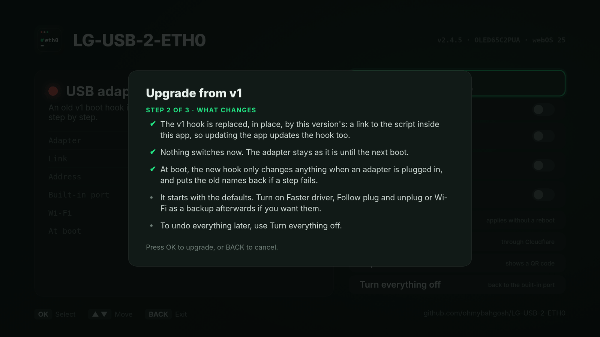

**Step 3: upgraded and checked.**  The app upgrades, then checks the new hook is in place, the old v1 file is gone, and the adapter is still `eth0`.  If anything didn't work, it shows what went wrong and points you to Report for GitHub.

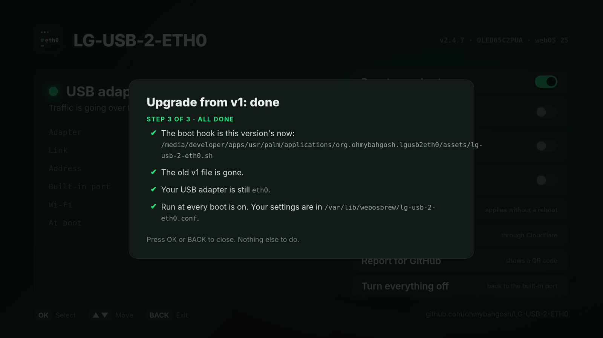

</details>

## Development and tests

The test suite runs the script against a fake `/sys` and a fake `ip`, so it needs no TV and no root, and touches nothing on your machine:

```sh
tests/run.sh busybox   # busybox sh with only busybox applets on PATH, closest to the TV
tests/run.sh dash
tests/run.sh bash
tests/run.sh busybox watch   # only tests whose name contains "watch"
```

CI runs ShellCheck and the whole suite under all three shells on every push, builds the TV app, and checks the issue forms.

<details>
<summary><b>What the tests cover, and the other tools in this repo</b></summary>

<br>

The tests cover swapping and reverting, Wi-Fi and tethering being left alone, MAC pinning, rename retries and rollback, the SSH session warning, the boot hook with and without an adapter, a late adapter, `--watch` hotplug, disable and enable, upgrading from v1, `--module` checks, moving an adapter to a new driver and falling back when that fails, `get-driver` refusing unknown kernels and bad checksums, falling back to the mirror and picking the driver by chip and adapter, `test-driver` (a driver that works, one that doesn't load, and one that froze the TV), keeping the faster driver after standby, the Wi-Fi fallback (and leaving Wi-Fi alone when it's already on), blocking updates with and without the Homebrew Channel's block (and undoing only its own changes), flagging a 100 Mbit/s or half-duplex link, the speed test, updates (refusing a bad checksum, for the app and the plain script, and what's new after one), and the report.  A fake `curl`, `luna-send`, `nyx-cmd`, `insmod` and `iptables` stand in for the network and the TV's services.

- **The TV app** is in `webos-app/`.  `webos-app/build.sh` builds the IPK and its Homebrew Channel manifest (it needs `ares-package` from `@webos-tools/cli`).
- **Screenshots, clips and the recording** come from the virtual TV (below): after changing the app, `sh webos-app/build.sh && sh scripts/virtual-tv/make-media.sh` makes them all again.  The update and v1 upgrade screenshots come from the built app with made-up data: `node scripts/screenshots/take.js` (it needs Playwright and ffmpeg).
- **A real TV** can be recorded too, open the app on it, forward its web inspector over SSH (`ssh -N -L 19998:127.0.0.1:9998 root@TV`), and run `node scripts/screenshots/record-tv.js`.  It only opens the Wi-Fi backup and report boxes, closes them with BACK, and changes nothing.
- **The virtual TV** runs the TV app on your computer against the real script, with no TV: `scripts/virtual-tv/vtv.sh setup c9` builds a made-up TV (a fake `/sys` and TV commands, from the test suite's fakes), and `node scripts/virtual-tv/server.js` serves the app at `http://127.0.0.1:8730/`, where its commands run on that TV under busybox `sh`.  `node scripts/virtual-tv/record.js --scenario c9 --steps 'wait:3000 down*2 ok wait:2000 back' --mp4 out.mp4` records it headless, with the remote's keys.  `vtv.sh list` shows the TVs: C2s with and without the faster driver and with a driver to test, and C9s before and after Realtek mode moves their RTL8153 to the kernel's own `r8152`.
- **The banner** is `scripts/banner/banner.html`, made from the app icon and the status screenshot: `node scripts/banner/make.js` renders it to `assets/banner.webp`.
- **The firmware audit:** `scripts/firmware-audit/audit.sh` unpacks an LG firmware file and lists the USB network drivers its kernel has ([docs/firmware-audit.md](docs/firmware-audit.md)).
- **Driver builds:** `scripts/driver-build/build.sh` builds a driver for one kernel from LG's source and checks it ([docs/driver-build.md](docs/driver-build.md)).

Releases are made by pushing a `v*` tag.  The release workflow runs the tests, checks the tag against `VERSION` in the script, builds the app, and publishes the script, `SHA256SUMS`, the IPK, its manifest and the AI knowledge base (`lg-usb-2-eth0-for-ai.md`).  Then it tells ohmybahgosh.dev to refresh its Homebrew Channel repository.

</details>

## Contributing

Real TV reports help most: your model, webOS version, adapter chip, and the output of `report`.  Use the [compatibility report form](https://github.com/ohmybahgosh/LG-USB-2-ETH0/issues/new?template=compatibility-report.yml), or test a [new driver](#more-drivers-on-the-way) if your TV has one.  Questions and ideas go to [Discussions](https://github.com/ohmybahgosh/LG-USB-2-ETH0/discussions), and a working setup is welcome in Show and tell.

Pull requests are welcome.  Please keep the script POSIX `sh` (it has to run under busybox), and add or update a test in `tests/run.sh` for any change in behavior.  For security issues, see [SECURITY.md](SECURITY.md).  Everyone here is expected to follow the [code of conduct](CODE_OF_CONDUCT.md).

<details>
<summary><b>AI-assisted pull requests</b></summary>

<br>

They're welcome too, held to the same standard as the rest of this project: say in the pull request that AI was used, make sure you understand and have reviewed every change, and test it on a real TV (say which model and webOS version).  Set your assistant up first: give it the [AI knowledge base](https://github.com/ohmybahgosh/LG-USB-2-ETH0/releases/latest/download/lg-usb-2-eth0-for-ai.md) (or run `sh scripts/ai-context.sh`).  Coding agents read [AGENTS.md](AGENTS.md) and [CLAUDE.md](CLAUDE.md) on their own.  See [CONTRIBUTING.md](CONTRIBUTING.md) for the details.

</details>

### Translating the app

The app's text is in [`webos-app/src/i18n.js`](webos-app/src/i18n.js): copy the `es` block and the `esScript` patterns (the script's status messages), translate them (keep the `{placeholders}` and `$1`s), and add the language to `NAMES`, `DICTS` and `SCRIPTS`.  The four messages the boot hook shows on the TV are in the script's `toast_text()`, and the script accepts the language code in `app_lang`, `settings_ok` and `load_settings`.  `node tests/check-i18n.js` checks that nothing is missing and that no English is left in the status messages.  A partly done language works too: anything untranslated shows in English.

## Special thanks

Everyone who has helped build LG-USB-2-ETH0 with code, driver tests, compatibility reports, ideas or bug reports.  This list updates itself when a pull request is merged or an issue or discussion is opened.  [Join them](#contributing).

<!-- thanks:start -->
<p>
  <a href="https://github.com/xbmcjase" title="xbmcjase: 2 driver tests, 2 compatibility reports"></a>
  <a href="https://github.com/Yevrashka" title="Yevrashka: 2 driver tests, 2 compatibility reports"></a>
  <a href="https://github.com/tirth0jain" title="tirth0jain: 2 driver tests, 1 compatibility report"></a>
  <a href="https://github.com/izoT3P" title="izoT3P: 3 compatibility reports"></a>
  <a href="https://github.com/romansat" title="romansat: 1 compatibility report, 1 discussion"></a>
  <a href="https://github.com/artemisxrpg" title="artemisxrpg: 1 compatibility report"></a>
  <a href="https://github.com/jasonchangandsrarhchen" title="jasonchangandsrarhchen: 1 compatibility report"></a>
  <a href="https://github.com/Mazda77" title="Mazda77: 1 discussion"></a>
  <a href="https://github.com/OCT0PUSCRIME" title="OCT0PUSCRIME: 1 discussion"></a>
  <a href="https://github.com/PargsZ" title="PargsZ: 1 compatibility report"></a>
</p>

- **[xbmcjase](https://github.com/xbmcjase)**: 2 driver tests, 2 compatibility reports
- **[Yevrashka](https://github.com/Yevrashka)**: 2 driver tests, 2 compatibility reports
- **[tirth0jain](https://github.com/tirth0jain)**: 2 driver tests, 1 compatibility report
- **[izoT3P](https://github.com/izoT3P)**: 3 compatibility reports
- **[romansat](https://github.com/romansat)**: 1 compatibility report, 1 discussion
- **[artemisxrpg](https://github.com/artemisxrpg)**: 1 compatibility report
- **[jasonchangandsrarhchen](https://github.com/jasonchangandsrarhchen)**: 1 compatibility report
- **[Mazda77](https://github.com/Mazda77)**: 1 discussion
- **[OCT0PUSCRIME](https://github.com/OCT0PUSCRIME)**: 1 discussion
- **[PargsZ](https://github.com/PargsZ)**: 1 compatibility report
<!-- thanks:end -->

## Thanks

A big thank you to **[DonZoomik](https://github.com/DonZoomik)** for [webos-r8152](https://github.com/DonZoomik/webos-r8152).  He found the right kernel source in LG's open-source bundles, built Realtek's current driver for webOS 25 under its own name so it can sit beside the TV's built-in one, and tracked down the scatter-gather setting that hangs the TV's USB controller.  He also published careful benchmarks.  That work is what turns a USB adapter on these TVs from "works, but drops out" into a steady connection, and `get-driver`, `--module` and the drivers built here all rest on it.  If it helps you too, go give his repo a star.

Thanks to **[mbenitez343](https://github.com/mbenitez343/lg-webos-2024-ethernet-fix)** too, for building and sharing the `r8152` driver that brings wired USB Ethernet back to 2024 LG TVs, to **[OCT0PUSCRIME](https://github.com/OCT0PUSCRIME/lg-webos-ax88179-driver)** for building ASIX's driver for webOS 5, testing it with LG-USB-2-ETH0 and sharing his build steps, to **[dd3git](https://github.com/dd3git/lg-webos-ax88179-driver)** for the ASIX driver for 2025 TVs, source included, and to **[throwaway96](https://github.com/throwaway96/webos-kernel-drivers)** for building kernel modules for so many webOS chips.

Thanks also to the [webOS Homebrew](https://www.webosbrew.org/) project for the Homebrew Channel and the startup hooks this script relies on, and to [RootMyTV](https://rootmy.tv/) for making rooting possible.

## License

MIT.  See [LICENSE](LICENSE).  Made by **OhMyBahGosh** ([@ohmybahgosh](https://github.com/ohmybahgosh)).  Not affiliated with LG Electronics.
