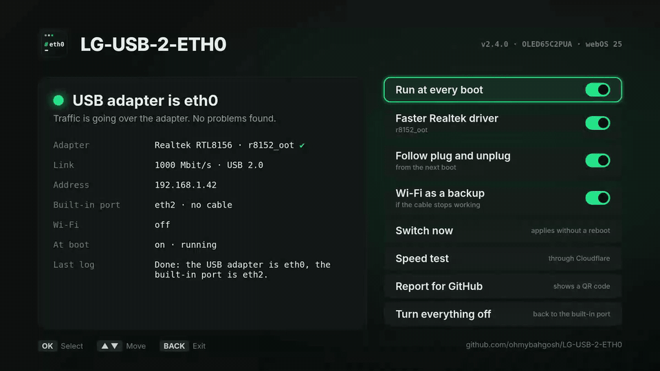

<div align="center">

# LG-USB-2-ETH0

**Make a USB Ethernet adapter the TV's `eth0` on rooted LG webOS TVs, safely and at every boot.**

[](https://github.com/ohmybahgosh/LG-USB-2-ETH0/actions/workflows/ci.yml)
[](https://github.com/ohmybahgosh/LG-USB-2-ETH0/releases/latest)
[](LICENSE)
[](https://github.com/tolgakurtuluss/awesome-webos)
[](https://ohmybahgosh.dev/lg-usb-2-eth0/)
[](https://github.com/ohmybahgosh/LG-USB-2-ETH0/stargazers)


</div>

LG TVs ship with a 100 Mbit/s wired port.  A gigabit USB adapter is two to three times faster on the same TV, even on the USB 2.0 ports many models have (a 2022 C2 included), but webOS names it `eth1`, and parts of webOS only look at `eth0`.  So the settings screen says "Not Connected" while the internet works, and some streaming apps refuse to play.

This script renames the adapter to `eth0` and parks the built-in port under another name, so webOS and its apps treat the adapter as the TV's wired connection.  A small boot hook does it again at every start.

> [!TIP]
> **Is it safe, and how do I undo it?**
> It adds one boot hook, a link at `/var/lib/webosbrew/init.d/S01fix-eth`, keeps its settings in `/var/lib/webosbrew/lg-usb-2-eth0.conf`, and only renames network interfaces.  No system files are touched, and network settings only if you turn on the Wi-Fi backup, so a reboot without the hook always starts clean.  With no adapter plugged in, the hook changes nothing.
> Undo everything with **Turn everything off** in the TV app, or `sh LG-USB-2-ETH0.sh uninstall --now`.

> [!NOTE]
> **How this is built.**  I, [OhMyBahGosh](https://github.com/ohmybahgosh), wrote v1 by hand.  From v2.0 on, it's written with AI coding agents (Claude), directed, reviewed and tested by me.  I've been building software for over 17 years.  My day job is data engineering, and network security and pentesting are what I do for fun.  AI writes a lot of the code here; I decide what it does, check how it does it, and nothing ships until it's run on a real TV (an LG C2 on webOS 25).
>
> The fixes that mattered most came from that real-TV testing, not from the AI: standby putting the adapter back on the slow driver, webOS quietly sending traffic over Wi-Fi instead of the adapter, and the GitHub report form opening blank on a phone.  The [changelog](CHANGELOG.md) has the full story.
>
> - **Tests on every push:** 60+ [tests](tests/run.sh) run the script against a fake `/sys` under busybox `sh` (the TV's shell), dash and bash, along with ShellCheck, a build of the TV app, and a check of the issue forms.  The CI badge above shows the latest run.
> - **Checked downloads:** driver modules and updates come from fixed releases or commits and are kept only if their SHA-256 matches.  A driver is only loaded on the exact kernel it was built for, and only offered for adapters it supports.
> - **Hard to break the TV:** no system files are touched, the boot hook is a link that stops running if the app is removed, every change has a fallback, and a reboot without the hook always starts clean.
>
> The driver modules `get-driver` offers aren't part of this code: [DonZoomik](https://github.com/DonZoomik/webos-r8152) and [mbenitez343](https://github.com/mbenitez343/lg-webos-2024-ethernet-fix) built them, and this script only checks and loads them.  Commits list me as the author and Claude as the committer, which is why they show as Verified.  Found a problem?  See [SECURITY.md](SECURITY.md) or open an issue.

## Contents

- [The TV app](#the-tv-app)
- [Quick start](#quick-start)
- [What it fixes](#what-it-fixes)
- [Commands and options](#commands-and-options)
- [How it works](#how-it-works)
- [Choosing an adapter](#choosing-an-adapter)
- [A faster driver for Realtek adapters](#a-faster-driver-for-realtek-adapters)
- [webOS compatibility](#webos-compatibility)
- [Real speeds](#real-speeds)
- [Troubleshooting](#troubleshooting)
- [FAQ](#faq)
- [Upgrading from v1](#upgrading-from-v1)
- [Development and tests](#development-and-tests)
- [Contributing](#contributing)
- [Thanks](#thanks)

## The TV app

The easiest way in.  It runs the same script underneath, as root through the Homebrew Channel, so you don't need SSH at all.  It works with the remote's arrows and OK, or the Magic Remote pointer.

<p align="center">
  
</p>

<table>
  <tr>
    <td width="50%"></td>
    <td width="50%"></td>
  </tr>
  <tr>
    <td align="center"><b>Status at a glance</b></td>
    <td align="center"><b>Speed test</b></td>
  </tr>
  <tr>
    <td width="50%"></td>
    <td width="50%"></td>
  </tr>
  <tr>
    <td align="center"><b>Report for GitHub</b></td>
    <td align="center"><b>Updates</b></td>
  </tr>
</table>

<sub>Screenshots use made-up data from <a href="scripts/screenshots/">scripts/screenshots</a>, matching a C2 with an RTL8156 adapter.</sub>

- **Status at a glance:** whether the adapter is `eth0`, its driver, link speed, USB bus, address, Wi-Fi, and any problems found, like a cable that only connects at 100 Mbit/s.
- **Run at every boot**, **Follow plug and unplug**, **Wi-Fi as a backup** and **Switch now**, as on/off switches.
- **Faster Realtek driver:** only shows up when a driver is known for your TV's exact kernel and a Realtek adapter is plugged in.  It downloads, checks and sets up the driver in one go.
- **Speed test:** download, upload and latency through the TV's current connection, against Cloudflare's nearest server.
- **Report for GitHub:** a QR code that opens a compatibility report on your phone with your TV, adapter, speed and the full report already filled in (MAC addresses hidden).
- **Updates:** tells you when a new version is out.  If you installed through the Homebrew Channel repo below, the update comes from there.  Otherwise the app downloads it, checks its SHA-256, and installs it itself.
- **Turn everything off:** removes the boot hook and gives `eth0` back to the built-in port.  Do this before you remove the app.

**Install it from the Homebrew Channel:** open the Homebrew Channel, go to Settings, add the repository `https://ohmybahgosh.dev/repo`, then install **LG-USB-2-ETH0** from the list.  The Homebrew Channel then offers updates like for any other app.

**Or install the IPK yourself:** download `org.ohmybahgosh.lgusb2eth0_*.ipk` from the [latest release](https://github.com/ohmybahgosh/LG-USB-2-ETH0/releases/latest) and install it with `ares-install`, or on the TV:

```sh
luna-send -n 1 luna://com.webos.appInstallService/dev/install '{"id":"org.ohmybahgosh.lgusb2eth0","ipkUrl":"/tmp/org.ohmybahgosh.lgusb2eth0_2.4.0_all.ipk"}'
```

Already set up with the script over SSH?  Open the app and it picks up your settings.  Its boot hook links to the copy of the script inside the app, so the app and the hook always run the same version.

## Quick start

Prefer SSH, or want to see every step?  This is the same thing without the app.

You need:

- A rooted LG TV with the [Homebrew Channel](https://github.com/webosbrew/webos-homebrew-channel).  Check yours at [cani.rootmy.tv](https://cani.rootmy.tv/).
- SSH (or telnet) access as root.
- **A Wi-Fi connection while you set this up.**  Renaming takes the wired ports down for a moment.

On the TV:

```sh
cd /tmp

# Download the latest release and its checksum
curl -fsSLO https://github.com/ohmybahgosh/LG-USB-2-ETH0/releases/latest/download/LG-USB-2-ETH0.sh
curl -fsSLO https://github.com/ohmybahgosh/LG-USB-2-ETH0/releases/latest/download/SHA256SUMS
sha256sum -c SHA256SUMS

# See what the TV has before changing anything (read-only)
sh LG-USB-2-ETH0.sh status

# Install the boot hook (asks before it writes anything)
sh LG-USB-2-ETH0.sh install

# Optional: switch right now instead of at the next reboot
sh LG-USB-2-ETH0.sh apply
```

No `curl`?  Use `wget` the same way.  If both fail with a TLS error (common on older firmware), download the two files on your computer and copy them over with `scp`.

Run `sh LG-USB-2-ETH0.sh` with no arguments for a menu.

<details>
<summary>What <code>status</code> looks like once it's working</summary>

```
=== LG-USB-2-ETH0 v2.3 status ===
Model:     OLED65C2PUA
webOS:     webOS 25 (10.x), firmware 33.x
Kernel:    aarch64, 5.4.x

Boot hook
  Installed and enabled (/var/lib/webosbrew/init.d/S01fix-eth -> /home/root/lg-usb-2-eth0/LG-USB-2-ETH0.sh)
  Waits 120s

Network interfaces
  eth0      USB Ethernet       driver r8152          00:e0:4c:68:12:34
            cable in, link 1000 Mbit/s, IPv4 192.168.1.42/24, on USB 2.0
  eth2      built-in Ethernet  driver lg-eth         a8:23:fe:00:00:01
            no cable, IPv4 none
  wlan0     Wi-Fi              driver mt7601u        00:11:22:33:44:55
            connected, IPv4 none
  Default route: eth0

USB network drivers on this kernel
  r8152(loaded) cdc_ncm(loaded) usbnet(loaded)

The USB adapter is eth0 and the built-in port is eth2.

Last log lines (/var/lib/webosbrew/lg-usb-2-eth0.log)
  Built-in eth0 -> eth2
  USB eth1 (r8152) -> eth0
  Done: the USB adapter is eth0, the built-in port is eth2.

No problems found.
```

This sample comes from the test suite, with example TV details filled in.  Your model, firmware and driver names will differ.

</details>

## What it fixes


| Problem | What you see | What this does |
|---------|--------------|----------------|
| **Streaming apps fail** | Apps like Paramount+ refuse to play over `eth1` | The adapter becomes `eth0` |
| **"Not Connected" in settings** | webOS shows no wired connection while the adapter works | Interface names match what webOS expects |
| **100 Mbit/s built-in port** | High-bitrate remuxes, Plex and Moonlight stutter | Uses the faster adapter (see [Real speeds](#real-speeds)) |

## Commands and options

| Command | What it does |
|---------|--------------|
| `install` | Writes the boot hook.  Add `--now` to switch right away too. |
| `uninstall` | Removes the boot hook.  Add `--now` to give `eth0` back to the built-in port right away. |
| `apply` | Swaps the adapter in now, without touching the hook. |
| `revert` | Gives `eth0` back to the built-in port now.  (`reset` works too.) |
| `disable` / `enable` | Keeps the hook but stops it running at boot, or turns it back on. |
| `status` / `doctor` | Read-only report and checks.  Safe to run any time. |
| `report` | Short, paste-ready report for a GitHub issue.  MAC addresses are masked. |
| `get-driver` | Downloads a better driver module, if one is known to work on your exact kernel, and checks its checksum.  With `--file PATH`, checks and uses a copy you downloaded yourself.  See [A faster driver](#a-faster-driver-for-realtek-adapters). |
| `speedtest` | Latency, download and upload through the TV's current connection, against Cloudflare's nearest server.  Four streams for about six seconds each way, so it uses a few hundred MB.  The last result shows up in `report` and the app. |
| `update` | Checks for a newer release and installs it, after checking its SHA-256.  `--check` only checks.  Inside the app, it updates the whole app.  On its own, the script replaces itself (and the boot hook's copy).  Your settings stay. |

| Option | What it does |
|--------|--------------|
| `-y`, `--yes` | Answer yes to every question. |
| `--now` | With `install` or `uninstall`, also switch right away. |
| `--watch` | Keep watching after boot.  Plug the adapter in and it becomes `eth0`; unplug it and `eth0` goes back to the built-in port.  Starts from the next boot. |
| `--mac aa:bb:cc:dd:ee:ff` | Only ever promote that adapter.  Handy with more than one adapter. |
| `--wait 120` | Seconds the boot hook waits for the adapter to appear. |
| `--module /path/driver.ko` | Load this driver module at boot, and move the adapter from the generic `cdc_ncm` driver over to it.  Refuses a module built for another kernel.  See [A faster driver](#a-faster-driver-for-realtek-adapters). |
| `--driver NAME` | The driver name the module registers, if it can't be read from the file.  Rarely needed. |
| `--wifi-fallback` | Wi-Fi as a backup.  If `eth0` loses its cable link for a minute while Wi-Fi is off, turn Wi-Fi on, so the TV joins a network it already knows.  Once the cable works again for 30 seconds, turn Wi-Fi back off, so traffic returns to the adapter.  It only turns Wi-Fi off if it turned it on.  Starts from the next boot. |
| `--no-watch`, `--no-module`, `--no-mac`, `--no-wifi-fallback` | Turn that setting off again. |
| `--json` | With `status`, `speedtest` or `update --check`: machine-readable output.  The TV app uses it. |

The options you install with are saved in `/var/lib/webosbrew/lg-usb-2-eth0.conf`.  Run `install` again to change any of them; the ones you don't give are kept.

## How it works

At boot the Homebrew Channel runs everything in `/var/lib/webosbrew/init.d`.  The hook is a link to the script (inside the TV app, or a copy in `/home/root/lg-usb-2-eth0`), and its settings live in their own file, so updating the script never loses them.  At boot it:

1. Starts a background job and returns at once, so other startup hooks and the Homebrew Channel's failsafe timer aren't held up.
2. Loads your `--module`, if you gave one.
3. Waits up to `--wait` seconds for a USB Ethernet adapter.  A device counts only if it's wired Ethernet on the USB bus, and not Wi-Fi (a USB device on many LG TVs), a phone or a modem.
4. If none turns up, it changes nothing and the built-in port stays `eth0`.
5. With `--module`, it moves the adapter from the generic `cdc_ncm` driver to your module's driver.  If the module doesn't take it within a few seconds, it goes back to `cdc_ncm`.  Each adapter gets one try per boot.
6. It renames the built-in `eth0` to `eth2` and the adapter to `eth0`, then brings both up.  A rename that webOS interrupts is retried, and if a step still fails, the old names are put back.
7. With `--watch`, it keeps checking every few seconds and follows the adapter being plugged in or out.
8. With `--module`, it also keeps the adapter on the faster driver.  Standby resets the TV's USB ports, and the adapter comes back on `cdc_ncm`, so the hook moves it over again.  The check every few seconds only looks at a couple of `/sys` folders, so it costs next to nothing.
9. With `--wifi-fallback`, it checks whether `eth0` still has a cable link (one `/sys` file).  After a minute without one, if Wi-Fi is off, it turns Wi-Fi on through webOS's own connection manager, the same switch as in the TV's settings, and turns it off again once the cable has worked for 30 seconds.  It remembers turning Wi-Fi on in `/var/lib/webosbrew/lg-usb-2-eth0.wifi`, so that still happens after a reboot in between.

It logs to `/var/lib/webosbrew/lg-usb-2-eth0.log` (it starts over once it reaches 32 KB), and `status` shows the last lines.  `apply` and `revert` run detached from your SSH session, so they finish even when the session drops, and they warn you first if you're connected through a port that's about to change.

## Choosing an adapter

What decides whether this works on your TV is **whether its kernel has a driver for your adapter's chip**.  That varies by model and firmware, not just by webOS version.  The chip matters more than the brand.

- **Realtek RTL8153 (gigabit) and RTL8156 (2.5G):** the most common chips.  Newer kernels may only have the generic `cdc_ncm` driver for them, which works but is slower.
- **ASIX AX88179:** works out of the box on many older TVs.  One report of the newer AX88179A not being detected on webOS 25.
- **USB 2.0 is fine.**  Many LG TVs, the C2 included, only have USB 2.0 ports.  There you'll top out around 300 Mbit/s, still about three times the built-in port.  If your TV does have a USB 3.0 port (usually the blue one), use it for more.

### Tested adapters

Adapters confirmed on a real TV.  Plain links: no affiliate codes, no sponsorship, nobody paid for a spot here.

| Adapter | Chip | Tested on | Result |
|---------|------|-----------|--------|
| [UGREEN USB-C to 2.5G Ethernet (Amazon)](https://www.amazon.com/dp/B0CD1FDKT1) | Realtek RTL8156BG (`0bda:8156`) | 2022 C2, webOS 25, USB 2.0 port | Works.  272 Mbit/s down, 287 up with `r8152_oot` (it's on `cdc_ncm` without it) |

It has a USB-C plug, and LG TVs have USB-A ports, so it's plugged in through a small USB-C (female) to USB-A (male) adapter ([this 4-pack on Amazon](https://www.amazon.com/dp/B0BJ8YQ2LM)).  That's not the ideal setup: it's just what the author had on hand, and it works.  Those little adapters are USB 2.0, which is all the C2's port can do anyway, but on a TV with a USB 3.0 port they'd hold the adapter back.  If you're buying, get a USB-A adapter like the ones below and skip the converter.

**Same chip, with a USB-A plug.**  These use the same Realtek RTL8156BG chip as the tested UGREEN, so they should get the same driver and similar results.  They haven't been tested on a TV yet, so a report helps.

| Adapter | Chip | Plug |
|---------|------|------|
| [UGREEN USB to 2.5G Ethernet, model 25051 (Amazon)](https://www.amazon.com/dp/B0CWV2Q6HJ) | RTL8156BG | USB-A, USB 3.0.  The USB-A version of the tested one. |
| [Cable Matters USB to 2.5Gb Ethernet, model 202485 (Amazon)](https://www.amazon.com/dp/B0GFHS6L87) | RTL8156BG | USB-A, USB 3.0 |
| [SABRENT USB-A to 2.5Gbps Ethernet, NT-UA25 (Amazon)](https://www.amazon.com/dp/B0FMBXSNKL) | RTL8156BG | USB-A, USB 3.0 |

Same deal: plain links, no affiliate codes.  Check the listing says RTL8156B or RTL8156BG before you buy, since sellers sometimes change parts.

Got another adapter working?  [Send a compatibility report](https://github.com/ohmybahgosh/LG-USB-2-ETH0/issues/new?template=compatibility-report.yml) (the TV app makes one for you) and it'll be added here.

Before buying, run `sh LG-USB-2-ETH0.sh status`.  It lists which USB network drivers your kernel has.  If you already have an adapter that isn't working, `status` tells you when the kernel sees it but has no driver for it.

## A faster driver for Realtek adapters

Many TVs give Realtek RTL8153 and RTL8156 adapters to the generic `cdc_ncm` driver.  It works, but it's slower and drops out under load.  The TV's own Realtek driver is often too old to recognize newer chips, and because it's built into the kernel, it can't be swapped out.  A newer Realtek driver, built for your exact kernel under a different name, fixes that.

[DonZoomik](https://github.com/DonZoomik/webos-r8152) built one, `r8152_oot` (Realtek's v2.22.1 driver), for kernel `5.4.268-329.ptl4tv.5`.  That kernel runs on at least the 2024 C4 and the 2022 C2 on webOS 25 (10.3.1, firmware 33.31.68).  If your TV runs that kernel, `status` says so, and two commands set it up:

```sh
sh LG-USB-2-ETH0.sh get-driver
sh LG-USB-2-ETH0.sh install --module /home/root/lg-usb-2-eth0/drivers/r8152_oot.ko
sh LG-USB-2-ETH0.sh apply      # optional: switch now instead of at the next reboot
```

**2024 QNED and OLED (K25lp / Paparoa) on webOS 25:** LG removed the Realtek driver from these TVs altogether, so a Realtek adapter gets no driver at all.  [mbenitez343](https://github.com/mbenitez343/lg-webos-2024-ethernet-fix) built the kernel's own `r8152` (v1.10.11) for kernel `5.4.268-294.17.paparoa.pine.2`.  It's for **gigabit RTL8152 and RTL8153 adapters** (like the TP-Link UE300), not 2.5G ones.  Same commands, with that file:

```sh
sh LG-USB-2-ETH0.sh get-driver
sh LG-USB-2-ETH0.sh install --module /home/root/lg-usb-2-eth0/drivers/r8152.ko
```

`get-driver` only offers a module for the exact kernel it was built for, and only when an adapter it supports is plugged in (it checks the adapter's USB ID against the module's own list).  It downloads from a fixed commit of the author's repository and keeps the file only if its SHA-256 matches.  The modules come from those projects, not this one, so credit and thanks go to DonZoomik and mbenitez343.

What LG-USB-2-ETH0 does with it:

- **Moves the adapter over.**  The kernel may still give the adapter to a generic driver first (`cdc_ncm`, or `cdc_ether` on TVs with no Realtek driver), so the script releases it and binds it to the new driver.  If that doesn't work within a few seconds, the adapter goes back where it was.  Only adapters the module lists as supported are moved, so a phone tethered over USB is never touched.
- **Turns off scatter-gather** on the new driver.  In DonZoomik's testing, it made the TV's USB controller hang after a while.
- **Never forces anything.**  A module built for another kernel is refused before it's loaded.  Each adapter gets one try per boot, so a driver that doesn't support it can't cause repeated drops.

**Set up Wi-Fi on the TV first.**  Moving drivers takes the adapter offline for a moment, and Wi-Fi is your way back in if something goes wrong.  A reboot always undoes a live switch, and `uninstall` removes it for good.

Already using DonZoomik's `r8152-autobind.sh`?  It does the same job.  Keep only one: run `sh /home/root/r8152-autobind.sh uninstall`, then install LG-USB-2-ETH0 with `--module`.  `status` warns if both are set up.

Have a module for a different kernel?  `install --module /full/path/driver.ko` works with any USB network driver built for your exact kernel (`uname -r`).

## webOS compatibility

The script only needs root, the Homebrew Channel, `ip` and `/sys`, which every rooted webOS TV has.  It's plain POSIX `sh` and is tested under busybox `sh`, the shell on the TV.

| webOS | What people have reported | Source |
|-------|---------------------------|--------|
| webOS 3.5 / 4 (2017 and 2018: B7, C7, C8) | ASIX-based adapters (Cable Matters USB 3.0) work out of the box.  TP-Link UE300 (RTL8153) didn't work on C7 or C8.  Settings show "no connection" while apps work, which is what this script fixes. | [lgwebos.com thread](https://www.lgwebos.com/topic/3395-gigabit-ethernet-on-smart-tv/page/2/) |
| webOS 24 | Where this script was first written. | |
| webOS 25 on a 2024 C4 | RTL8153 and RTL8156 adapters come up through the generic `cdc_ncm` driver.  They work, but slower and with drops.  A community-built `r8152` module helps. | [DonZoomik/webos-r8152](https://github.com/DonZoomik/webos-r8152) |
| webOS 25 (10.3.1, firmware 33.31.68) on a 2022 C2 (OLED65C2PUA), kernel `5.4.268-329.ptl4tv.5` | Tested by the author.  An RTL8156 adapter (`0bda:8156`) comes up on `cdc_ncm`, and LG-USB-2-ETH0 makes it `eth0`.  With `r8152_oot` from `get-driver` and `install --module`, it's confirmed through a full reboot: at startup the hook loads the driver, moves the adapter over on the first try, turns scatter-gather off and makes it `eth0`, with traffic going out the adapter.  The C2's USB port runs at USB 2.0 speed. | This repo |
| webOS 25 on 2024 QNED and OLED (Paparoa), kernel `5.4.268-294.17.paparoa.pine.2` | The Realtek driver was removed.  A gigabit RTL8153 adapter works with mbenitez343's `r8152` build (stable on a QNED86, per its author), which `get-driver` now offers.  Not yet tested with LG-USB-2-ETH0 on one of these TVs, so a report helps. | [mbenitez343/lg-webos-2024-ethernet-fix](https://github.com/mbenitez343/lg-webos-2024-ethernet-fix) |
| webOS 25 on a 2025 B5 | One report of an AX88179A not being detected at all. | [LG developer forum](https://forum.webostv.developer.lge.com/t/feature-request-usb-gigabit-ethernet-adapter-support-on-webos-25/28185) |

**Tested on your TV?**  Please [send a compatibility report](https://github.com/ohmybahgosh/LG-USB-2-ETH0/issues/new?template=compatibility-report.yml), whether it worked or not.  Reports from real TVs are what this table needs most.

## Real speeds

Don't expect gigabit.  The TV's USB port is the limit.  On a C2 at full speed, the busiest CPU core was only about a third busy, so tweaks like spreading network work over more cores or bigger buffers don't help.  Measured on real TVs:


| Setup | Speed | Source |
|-------|-------|--------|
| Built-in port (any model) | about 95 Mbit/s | 100 Mbit/s port |
| RTL8153 on a 2024 C4 (webOS 25), generic `cdc_ncm` driver | about 200 to 255 Mbit/s, with drops | [webos-r8152](https://github.com/DonZoomik/webos-r8152) |
| Same adapter with the community `r8152` module | about 290 to 330 Mbit/s | [webos-r8152](https://github.com/DonZoomik/webos-r8152) |
| Cable Matters adapter on a 2018 C8 | about 250 Mbit/s | [lgwebos.com thread](https://www.lgwebos.com/topic/3395-gigabit-ethernet-on-smart-tv/page/2/) |
| RTL8156 on a 2022 C2 (webOS 25, USB 2.0) with `r8152_oot` | 272 Mbit/s down, 287 up, 7 ms | This repo, with `speedtest` |

That's still two to three times the built-in port, which is plenty for 4K remuxes.

## Troubleshooting

**Lost SSH while switching?**  The switch still finishes on the TV.  Reconnect over Wi-Fi.  The adapter has its own MAC address, so your router may give the TV a new IP.  A DHCP reservation for the adapter's MAC keeps it steady.

**Want everything back the way it was?**  `sh LG-USB-2-ETH0.sh uninstall --now`.  Or just `uninstall` and reboot.

**Wi-Fi on too?**  webOS may send traffic over Wi-Fi while it's connected, even with the adapter working.  `status` warns when that happens.  Turn Wi-Fi off in the TV's settings once the adapter works, or keep it on only as a way back in while you set things up.  To have Wi-Fi as a backup without it taking over, turn it off and use `--wifi-fallback`.

**Link only 100 Mbit/s?**  `status` and the app flag it.  The adapter connected to your router or switch at 100 Mbit/s, so it's no faster than the built-in port.  It's usually the cable: flat and older cables often have only two of the four wire pairs.  Try a Cat5e or better cable, another port, or check the router's port speed.

**Both cables plugged in?**  Unplug the built-in one.  With two wired links up, traffic can take the slower port.

**Settings still say "Not Connected", or no IP?**  Run `status`.  If the adapter is `eth0` but has no IPv4 address, give webOS a moment, then try unplugging and replugging the network cable.

<a id="adapter-not-detected"></a>**Adapter not detected?**  `status` lists adapters the kernel sees but has no driver for.  Try an adapter with a different chip, another USB port, or a powered hub.  Run `get-driver` to see if a better driver is known for your kernel.  If someone has built a driver module for your exact kernel (`uname -r`), install with `--module /full/path/driver.ko`.  The script refuses a module built for another kernel.

**Adapter plugged in after boot, or unplugged and back?**  Without `--watch`, run `apply`, or reboot.  With `--watch`, it's handled for you.

**Something went wrong at boot?**  The hook only renames interfaces (and loads your `--module`, if you gave one), so a reboot without it always starts clean.  If the Homebrew Channel drops into failsafe mode, telnet in, run `uninstall`, and reboot.

**Still stuck?**  Run `sh LG-USB-2-ETH0.sh report` and paste the output into a [bug report](https://github.com/ohmybahgosh/LG-USB-2-ETH0/issues/new?template=bug-report.yml).

## FAQ

**Does it survive a firmware update?**  The hook lives in the Homebrew Channel's folder, so it stays as long as root does.  If an update removes root, the hook stops running and the TV just goes back to using the built-in port.

**Does it change my network settings?**  No.  webOS still sets up the wired connection itself.  The script only changes which device is called `eth0`.  The one exception is `--wifi-fallback`, if you turn it on: it flips the Wi-Fi switch on when the cable stops working, and back off when it works again.

**Does it affect Wi-Fi?**  No, unless you turn on `--wifi-fallback`.  Wi-Fi modules are never renamed or moved, even the ones that sit on USB.

**What about phone tethering or a USB modem?**  Those are skipped too (`rndis_host`, `ipheth`, `cdc_mbim`, `qmi_wwan`).

**Can I use two adapters?**  Yes.  Pin the one you want with `--mac`.  Without it, the first adapter with a cable in wins.

**Does it work on non-LG webOS devices?**  It's written for LG TVs with the Homebrew Channel.  It may work elsewhere, but that isn't tested.

## Upgrading from v1

Run `sh LG-USB-2-ETH0.sh install`.  It replaces the v1 hook in place (same file name).  If you had "disabled" v1, `status` flags it: on TVs where `run-parts` is busybox's, the `.disabled` file kept running at boot.  `disable` moves it out of `init.d`, or `install` replaces it.  See the [changelog](CHANGELOG.md) for everything that changed.

## Development and tests

The test suite runs the script against a fake `/sys` and a fake `ip`, so it needs no TV and no root, and touches nothing on your machine:

```sh
tests/run.sh busybox   # busybox sh with only busybox applets on PATH, closest to the TV
tests/run.sh dash
tests/run.sh bash
tests/run.sh busybox watch   # only tests whose name contains "watch"
```

It covers swapping and reverting, Wi-Fi and tethering being left alone, MAC pinning, rename retries and rollback, the SSH session warning, the boot hook with and without an adapter, a late adapter, `--watch` hotplug, disable and enable, upgrading from v1, `--module` checks, moving an adapter to a new driver and falling back when that fails, `get-driver` refusing unknown kernels and bad checksums, keeping the faster driver after standby, the Wi-Fi fallback (and leaving Wi-Fi alone when it's already on), flagging a 100 Mbit/s or half-duplex link, the speed test, updates (refusing a bad checksum, for the app and the plain script), and the report.  A fake `curl` and `luna-send` stand in for the network and the TV's services.  CI runs ShellCheck and the whole suite under all three shells on every push.

The TV app is in `webos-app/`.  `webos-app/build.sh` builds the IPK and its Homebrew Channel manifest (it needs `ares-package` from `@webos-tools/cli`).  CI builds it on every push, and checks the issue forms too.

The app screenshots and the GIF above come from the built app running in a desktop browser with made-up data.  After changing the app, `sh webos-app/build.sh && node scripts/screenshots/take.js` takes them again (it needs Playwright and ffmpeg).

Releases are made by pushing a `v*` tag.  The release workflow runs the tests, checks the tag against `VERSION` in the script, builds the app, and publishes the script, `SHA256SUMS`, the IPK, its manifest and the AI knowledge base (`lg-usb-2-eth0-for-ai.md`).  Then it tells ohmybahgosh.dev to refresh its Homebrew Channel repository.

## Contributing

Real TV reports help most: your model, webOS version, adapter chip, and the output of `report`.  Use the [compatibility report form](https://github.com/ohmybahgosh/LG-USB-2-ETH0/issues/new?template=compatibility-report.yml).

Pull requests are welcome.  Please keep the script POSIX `sh` (it has to run under busybox), and add or update a test in `tests/run.sh` for any change in behavior.  For security issues, see [SECURITY.md](SECURITY.md).

AI-assisted pull requests are welcome too, held to the same standard as the rest of this project: say in the pull request that AI was used, make sure you understand and have reviewed every change, and test it on a real TV (say which model and webOS version).  Set your assistant up first: give it the [AI knowledge base](https://github.com/ohmybahgosh/LG-USB-2-ETH0/releases/latest/download/lg-usb-2-eth0-for-ai.md) (or run `sh scripts/ai-context.sh`).  Coding agents read [AGENTS.md](AGENTS.md) and [CLAUDE.md](CLAUDE.md) on their own.  See [CONTRIBUTING.md](CONTRIBUTING.md) for the details.

## Thanks

A big thank you to **[DonZoomik](https://github.com/DonZoomik)** for [webos-r8152](https://github.com/DonZoomik/webos-r8152).  He found the right kernel source in LG's open-source bundles, built Realtek's current driver for webOS 25 under its own name so it can sit beside the TV's built-in one, and tracked down the scatter-gather setting that hangs the TV's USB controller.  He also published careful benchmarks.  That work is what turns a USB adapter on these TVs from "works, but drops out" into a steady connection, and `get-driver` and `--module` are built on it.  If it helps you too, go give his repo a star.

Thanks to **[mbenitez343](https://github.com/mbenitez343/lg-webos-2024-ethernet-fix)** too, for building and sharing the `r8152` driver that brings wired USB Ethernet back to 2024 LG TVs.

Thanks also to the [webOS Homebrew](https://www.webosbrew.org/) project for the Homebrew Channel and the startup hooks this script relies on, and to [RootMyTV](https://rootmy.tv/) for making rooting possible.

## License

MIT.  See [LICENSE](LICENSE).

## Author

**OhMyBahGosh** ([@ohmybahgosh](https://github.com/ohmybahgosh))
